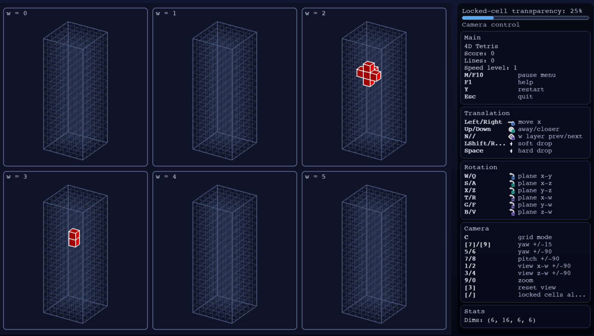

# Tet4D

Tet4D is a playable 2D/3D/4D Tetris-like project about learning to think
spatially beyond ordinary 3D intuition. Run the **Godot 4.7.2 game** for the
current bounded 2D/3D/4D product, or the **Python/pygame version** for its
playable frontends, Topology Playground, sandbox, and simulation tools.

[Godot setup and launch](#godot-version) ·
[Python setup and launch](#python-version) ·
[Troubleshooting](#troubleshooting) ·
[Development](#development-and-verification)

## Install and Run

These source-checkout commands use Bash or zsh. Run them from the repository
root, keeping environment setup and launch commands in the same terminal.
For packaged applications and platform support, see
[Build Installers and Releases](#build-installers-and-releases).

### Shared Dependency Setup

Both versions need **Python 3.11+**: Python runs the pygame version and the
pinned SCons build tool for Godot's native extension. On first use, install the
declared runtime and development dependencies:

```bash
./scripts/bootstrap_env.sh
```

If this machine has no approved interpreter configured yet, select an existing
Python 3.11+ executable explicitly for this first bootstrap, replacing the
placeholder with its absolute path:

```bash
GOVERNANCE_PYTHON=/absolute/path/to/python3 ./scripts/bootstrap_env.sh
```

Bootstrap creates the checkout's editable `.venv` in installed mode, or
synchronizes dependencies into an already configured shared environment in
source mode. Manual virtual-environment activation is unnecessary. See
[Python Environment Details](#python-environment-details) for shared-environment
configuration.

### Godot Version

**Prerequisites:** complete the shared dependency setup above, install Git and a
C++17 compiler toolchain, and install the exact pinned Godot editor:
`4.7.2.stable.official.ed1daf0bf`. The official archive URLs, checksums, and
executable paths are recorded in
[the toolchain policy](config/project/policy_pack.json). The
[Godot guide](godot/Tet4D.Godot/README.md#quick-start) describes the engine and
native-extension pins. Matching export templates are needed when building
installers; local play uses the editor and native extension.

First-time native build, and again after native source or binding changes:

```bash
eval "$(./gov env)"
git submodule update --init --recursive
./scripts/build_godot_tet4d_core.sh
```

Launch the game in each new terminal session. Replace the placeholder with the
Godot executable, for example
`/Applications/Godot.app/Contents/MacOS/Godot` on macOS:

```bash
GODOT_BIN=/absolute/path/to/Godot
"$GODOT_BIN" --path godot/Tet4D.Godot res://scenes/game_bootstrap.tscn
```

The game offers bounded 2D, 3D, and 4D live play with NEXT, Ghost, Hold, setup,
settings, controls/help, and replay demos under `Advanced / Diagnostics`.
To open the separate Designer shell (Design Laboratory and Presentation
Designer), use the same executable with its scene:

```bash
"$GODOT_BIN" --path godot/Tet4D.Godot res://scenes/designer_bootstrap.tscn
```

### Python Version

**Prerequisites:** complete the shared dependency setup above. It installs
`pygame-ce` and the project's other declared dependencies.

Launch the full game and tools menu in each new terminal session:

```bash
eval "$(./gov env)"
"$PYTHON_BIN" front.py
```

`gov env` selects the approved interpreter and, in source mode, sets
`PYTHONPATH` to this checkout's `src`. Keep both lines in the same terminal;
selecting an interpreter alone does not set its source path.

After that environment setup, choose one of these direct launch commands:

```bash
"$PYTHON_BIN" front.py --frontend 2d
"$PYTHON_BIN" front.py --frontend 3d
"$PYTHON_BIN" front.py --frontend 4d
"$PYTHON_BIN" cli/front.py --topology-playground
"$PYTHON_BIN" cli/front.py --topology-playground 4
```

The first three open the playable Python frontends. The last two open the
Topology Playground in its default 2D mode or directly in 4D.

## Which Version to Use

| Version | Main uses |
| --- | --- |
| Godot game | Current bounded 2D/3D/4D professional-core game, NEXT, Ghost, Hold, replay, setup, and accessibility infrastructure. |
| Godot Designer | Design Laboratory and Presentation Designer. |
| Python/pygame | Playable 2D/3D/4D frontends, Topology Playground, sandbox, and simulation tools. |

Python remains reference authority for inherited semantics that have not been
transferred. Native C++ powers accepted live sessions and owns authoritative
Hold; authority is subsystem-specific. See the
[authority map](docs/architecture/authority_map.md). Godot does not currently
host the Topology Playground.

## Troubleshooting

| Symptom | Action |
| --- | --- |
| `ModuleNotFoundError: No module named 'tet4d'` | From the repository root, run `eval "$(./gov env)"`, then rerun the launch command in that terminal. Source mode needs the source binding as well as the interpreter. |
| No approved bootstrap interpreter | Use the explicit `GOVERNANCE_PYTHON` command in Shared Dependency Setup, or configure an approved shared environment below. |
| Missing Python dependency or SCons | Rerun `./scripts/bootstrap_env.sh` for the selected environment. |
| Godot cannot load the native extension | Initialize the submodule and run the native build in the Godot quick start. |
| Godot version mismatch | Check `"$GODOT_BIN" --version` against the exact pinned build above. |

For interpreter and source-binding diagnostics, run:

```bash
./gov doctor
```

## Development and Verification

### Python Environment Details

Governed scripts resolve their interpreter themselves. For commands of your
own, initialize the environment with `eval "$(./gov env)"` and use
`"$PYTHON_BIN"`; avoid a bare `python` or `python3` from `PATH`.
`resolve_python_env.sh` prints only the interpreter, so it does not replace
`gov env` when a source binding is required.

To select one already-approved runtime interpreter for every worktree on a
machine, declare it once in the inherited workspace overlay:

```bash
mkdir -p "${XDG_CONFIG_HOME:-$HOME/.config}/workspace-governance"
cat > "${XDG_CONFIG_HOME:-$HOME/.config}/workspace-governance/tet4d-workspace.local.json" <<'JSON'
{"schema_version": 1, "interpreter": "/absolute/path/to/bin/python"}
JSON
```

Add `"execution_mode": "source"` there when that interpreter holds no editable
install of this project: every worktree then imports its own `src`, and
switching between them costs no reinstall. Ask the resolver for both at once:

```bash
eval "$(./gov env)"
```

It is keyed by workspace identity, so a worktree inherits it wherever it lives,
and it both starts governance and is certified: a fresh worktree with no `.venv`
and no bootstrap variables can run `./gov check` and `./gov doctor` from this
declaration alone. A repository `.governance/workspace.local.json` still
overrides the certified selection per checkout. It does not certify one shared
editable environment for multiple worktrees: each checkout still needs its own
editable-origin-valid environment.

`bootstrap_env.sh` is the only command that changes a Python environment, and
what it builds follows the declared mode: installed mode creates `.venv` and
installs this checkout editable into it, source mode synchronises declared
dependencies into the shared interpreter and installs no project, so no
worktree needs a `.venv` of its own. `verify_local.sh` creates nothing; it
reports an unready environment and runs the gate.

`bootstrap_env.sh` needs an approved interpreter to create the environment
from. It uses `GOVERNANCE_PYTHON`, else `$WORKSPACE_VENV/bin/python`, else the
inherited workspace overlay interpreter, else an existing `.venv`; on a machine
with none of those, declare the overlay above, export `WORKSPACE_VENV`, or set
`GOVERNANCE_PYTHON` to a Python satisfying `requires-python`. See
`docs/architecture/workspace_governance_v0_1.md` for the full contract.

### Checks

Python tests:

```bash
eval "$(./gov env)"
"$PYTHON_BIN" -m pytest -q
```

Canonical Godot verification with the exact editor selected above:

```bash
GODOT_BIN=/absolute/path/to/Godot ./scripts/verify_godot_4_7.sh
```

Native core build and parity tests:

```bash
./scripts/test_godot_tet4d_core.sh
native/tet4d_core/build/tests/geometry_core_tests --geometry-parity
native/tet4d_core/build/tests/query_core_tests --query-parity
```

Python-golden gameplay parity checks:

```bash
eval "$(./gov env)"
"$PYTHON_BIN" tools/migration/compare_cpp_gameplay_trace.py --all-plain-2d
"$PYTHON_BIN" tools/migration/compare_cpp_gameplay_trace.py --all-plain-nd
```

Primary verification gate:

```bash
CODEX_MODE=1 ./scripts/verify.sh
```

### Developer References

- Packaging:
  - `packaging/godot/build_macos.sh`
- Verification:
  - `scripts/ci_check.sh`
  - `tools/governance/scan_secrets.py`
  - `tools/governance/check_pygame_ce.py`
- Runtime config:
  - `config/gameplay/score_analyzer.json`
  - `config/project/io_paths.json`
  - `config/project/constants.json`
  - `config/project/policy/manifests/secret_scan.json`

## Build Installers and Releases

Build the current macOS 13+ Universal Godot release candidate with the exact
pinned Godot 4.7.2 editor and matching export templates:

```bash
GODOT_BIN=/absolute/path/to/Godot packaging/godot/build_macos.sh
```

See [Release Installers](docs/RELEASE_INSTALLERS.md) for the Godot and Python
product families, installer builds, artifact checks, outside-tree smoke
procedures, and current platform evidence.

### Known Limitations

- Python remains reference authority for inherited, untransferred semantics;
  authority is subsystem-specific rather than language-global.
- Godot is the current bounded 2D/3D/4D professional-core product shell.
- Native C++ powers accepted live sessions plus geometry/query helpers and
  owns authoritative Hold under `AE-0055`.
- Topology Playground, broader topology editing, and Python-first development flows still live in the Python launcher.
- The current supported release target is a macOS 13+ Universal Godot app/ZIP.
  Linux and Windows Godot artifacts are development-configured but not
  runtime-accepted release targets. The Python/PyInstaller desktop packages are
  an active, separately named product family; macOS arm64, Linux amd64, and
  Windows x64 package/install/runtime/removal proof is complete from one
  integrated source SHA. The unified release workflow now builds these three
  installers plus the four explicitly named Godot Designer packages from one
  source SHA and emits a checksum manifest after all seven pass.

## Project Background and Documentation



Tet4D began as a higher-dimensional Tetris experiment: falling pieces, slices,
rotations, projections, and the attempt to make four-dimensional structure
playable rather than merely diagrammed. The project connects the game,
structure-exploration tools, and reference/simulation work.

### Why This Exists

Tet4D is motivated by a philosophical question:

**Is ordinary 3D spatial intuition a fixed ceiling, or a trained habit?**

A strong Kantian reading treats Euclidean 3D space as a necessary form of human spatial experience: higher dimensions
can be calculated, projected, and reasoned about, but not truly inhabited by intuition.

Thomas Reid points in the opposite direction. His “geometry of visibles” suggests that practical spatial understanding
is not simply read off the eye. It is stabilized through vision, touch, movement, correction, and repeated action in
the world.

Tet4D turns that question into an artifact. If spatial intuition is trained by action, then a structured 4D world is
not only something to visualize. It is something a player might gradually learn to move inside.

For the longer philosophical background, see
[docs/philosophy/PHILOSOPHY.md](docs/philosophy/PHILOSOPHY.md).

### Documentation

- [Documentation index](docs/README.md)
- [Configuration reference](docs/CONFIGURATION_REFERENCE.md)
- [User settings reference](docs/USER_SETTINGS_REFERENCE.md)
- [Godot shell guide](godot/Tet4D.Godot/README.md)
- [Release installers](docs/RELEASE_INSTALLERS.md)
- Canonical governance: [AGENTS.md](AGENTS.md) and the six owners under
  [docs/governance/](docs/governance/)
- [Reusable governance pack](docs/WORKSPACE_GOVERNANCE_PACK.md)
- [Product requirements](docs/rds/)
- [Current open work](docs/BACKLOG.md)
