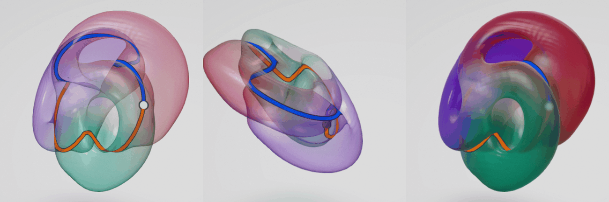
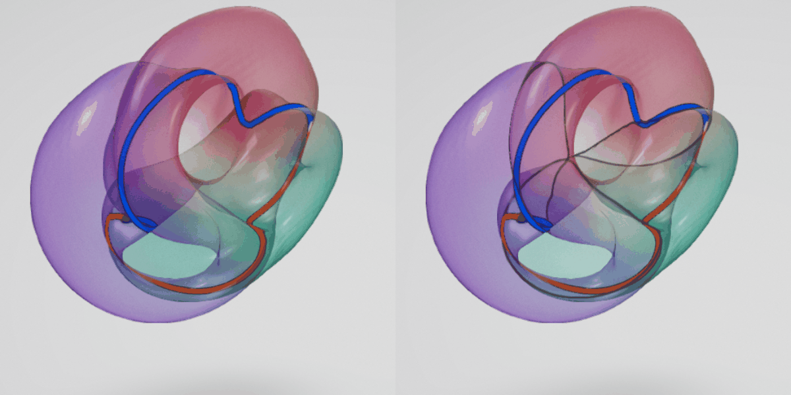
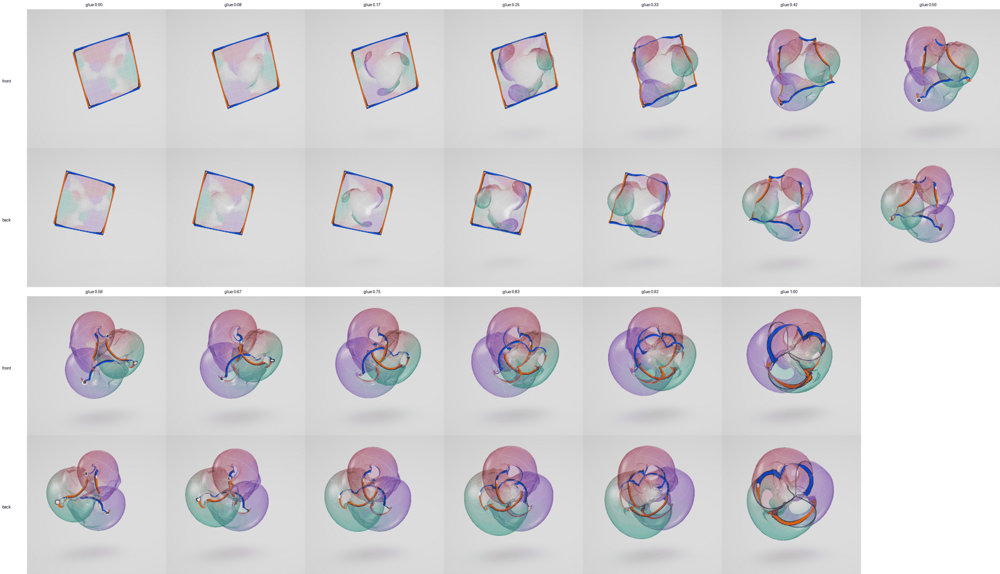
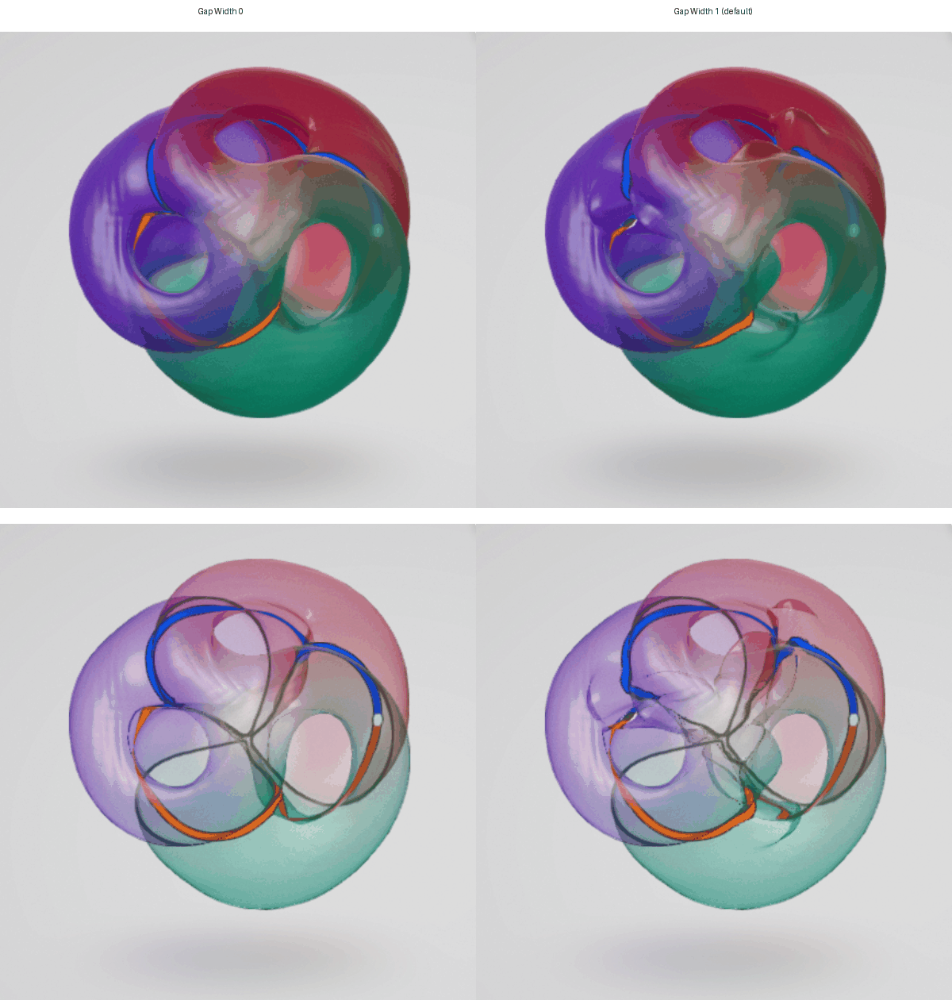
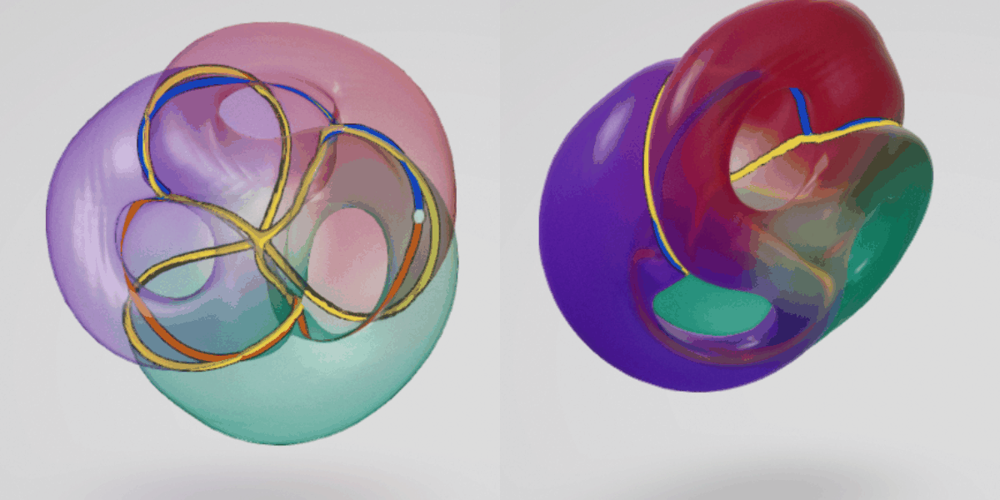

# Boy's surface viewer

An interactive WebGL2 viewer of Boy's surface, the Bryant–Kusner immersion of the real projective
plane ℝP² in ℝ³, rendered as frosted coloured glass.


Open [`boys-surface-viewer.html`](boys-surface-viewer.html) in a browser. It is a single
self-contained file with no network access and no dependencies.

**Controls**
- Drag to rotate. Right-drag, Shift-drag or middle-drag to move the shape around the canvas.
- Scroll to zoom. On touch screens, use two fingers to move and pinch to zoom.
- Double-click to recentre. **H**, or the round button at the top right, hides the panel.

**Panel**
- **Shape:** Glue (with ▶ to play it), presets, lobe length / width / thickness, interior slimming,
  gap width, twist.
- **Lines:** membranes (see below), square or polar parameter grid, the glued edges of the square, its
  corner points, and the self-intersection curve with its triple point.
- **Material:** glass opacity, clarity, frost, gloss, rim depth, and the lobe colours.
- **Scene:** spin, spin axis, floor shadow.

The **Square** grid and the **glued edges** are the same square, grid and edge colours as the last
frame of [the square-to-Boy's-surface sequence](../projective-plane-sequence/). Here they are shown
on the finished surface, which you can turn and look through.



**Membranes.** Each of the three tubes passes through the surface. The usual glass Klein bottle shows
its neck passing through a hole in the wall. In the same way, the viewer removes by default the small
disc of surface each tube passes through. These discs are bounded by the self-intersection curve, and a
dark ring marks the rim of each hole. Set **Membranes** to *Shown* to see the complete surface.



**Gluing.** The *Glue* slider (or ▶) stretches the flat square into Boy's surface, continuously,
and you can rotate it at any moment. The whole square, its grid, its four edges and its corners are
there all along:
- The centre of the square bulges into the three lobes.
- The edges lift off and wrap round into the slits.
- Each orange edge comes alongside the other orange one, and each blue alongside the other blue,
  until they meet at 1.
- Equal slider steps make equally large changes.



Animations: [front](gluing/gluing_front.webp), [back](gluing/gluing_back.webp).

Every in-between moment, from any angle, can be rendered with
[`tools/render_gluing.py`](tools/render_gluing.py):

```
python tools/render_gluing.py                                  # 13 steps, front and back (the image above)
python tools/render_gluing.py --glue 0:1:61 --view front --anim  # 61 steps and an animated WebP
python tools/render_gluing.py --glue 0.25,0.3,0.35             # chosen moments
python tools/render_gluing.py --view 30,20 --view -30,200      # any view: tilt,turn in degrees
python tools/render_gluing.py --style glass --set '{"gap": 0}' # the viewer's look, other settings
```

The default *edges* style makes the glass nearly clear, with a faint grid and thick edges and
corners.

**Gap width.** The narrow slits between the tubes and the central area open to about the tubes' width
(Gap Width 1, the default). Set it to 0 for the classic hairline slits.



**Self-intersections.** Tick *Self-Intersections* to draw where the surface passes through itself: three
loops (gold) that all meet at the triple point (gold disc).



How it works, and why it is built this way: [DESIGN.md](DESIGN.md).

**Tools**
- [`tools/slimming_field.py`](tools/slimming_field.py) regenerates the page's embedded slimming
  field (about two minutes). It needs numpy and scipy.
- [`tools/gap_field.py`](tools/gap_field.py) regenerates the page's embedded gap map (about eight
  minutes). It needs numpy and scipy.
- [`tools/membranes.py`](tools/membranes.py) regenerates the page's embedded membrane and curve
  data. It needs numpy and scipy.
- [`tools/fold_check.py`](tools/fold_check.py) confirms that no setting of the shape sliders folds
  the surface. It needs numpy and scipy.
- [`tools/render_gluing.py`](tools/render_gluing.py) renders the gluing at any glue values and view
  angles (frames, strip, animated WebP). It needs playwright and pillow.
- [`tools/check_viewer.py`](tools/check_viewer.py) runs 26 browser checks headless. It needs
  playwright, pillow and numpy.
