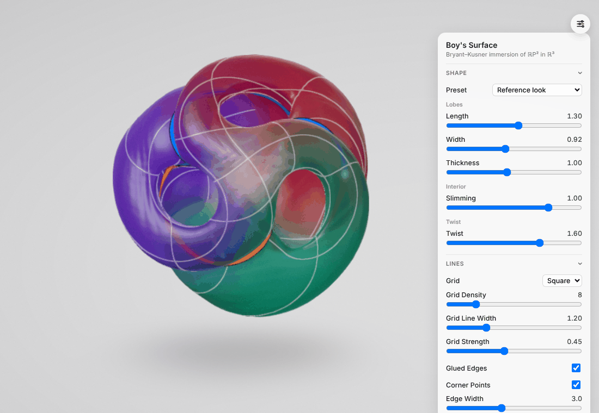

# Boy's surface viewer

An interactive WebGL2 viewer of Boy's surface, the Bryant–Kusner immersion of the real projective
plane ℝP² in ℝ³, rendered as frosted coloured glass.

Open [`boys-surface-viewer.html`](boys-surface-viewer.html) in a browser. It is a single
self-contained file with no network access and no dependencies.

**Controls**
- Drag to rotate. Right-drag, Shift-drag or middle-drag to move the shape around the canvas.
- Scroll to zoom. On touch screens, use two fingers to move and pinch to zoom.
- Double-click to recentre. **H**, or the round button at the top right, hides the panel.

**Panel**
- **Shape:** presets, lobe length / width / thickness, interior slimming, twist.
- **Lines:** square or polar parameter grid, the glued edges of the square, and its corner points.
- **Material:** glass opacity, clarity, frost, gloss, rim depth, and the lobe colours.
- **Scene:** spin, spin axis, floor shadow.

The **Square** grid and the **glued edges** are the same square, grid and edge colours as the last
frame of [the square-to-Boy's-surface sequence](../projective-plane-sequence/). Here they are shown
on the finished surface, which you can turn and look through.

How it works, and why it is built this way: [DESIGN.md](DESIGN.md).
