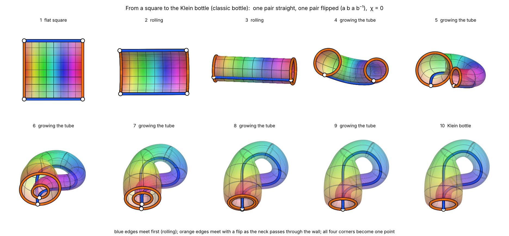
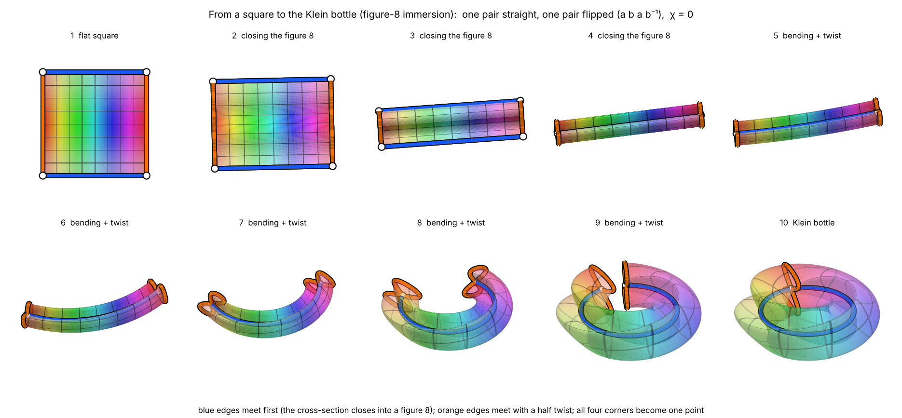

# From a square to the Klein bottle

**Gluing:** *a b a b⁻¹*. The blue edges are glued straight; the orange edges are glued with a flip.

**Corners:** all four become one point, so χ = 1 − 2 + 1 = 0.

The Klein bottle has no embedding in ℝ³, so every model of it in space passes through itself. There
are two sequences here, ending in the two standard models.

## Classic bottle

Animated version: [klein-bottle-sequence.webp](klein-bottle-sequence.webp). Single frames:
[`stages/bottle/`](stages/bottle/).

**Stages:**
- **1–3, rolling:** the square rolls into a cylinder until the blue edges meet.
- **4–10, growing the tube:** each frame is a longer piece of the bottle's tube. The growth slows
  down at the end, so the last frames show the two ends closing gradually.
- **The flip:** the neck passes through the wall, runs down inside the body and opens into a
  rounded base, where it meets the outer wall from inside. The two tube ends meet there as circles
  of the same size, flipped, so the orange edges meet with the flip.

The bottle is a tube of controlled thickness swept along a smooth centreline (the neck is never
thinner than about 0.4 of the body's width), rather than the usual closed-form parametrization,
whose neck pinches very thin.

The surface crosses itself along one circle, where the neck passes through the wall.

## Figure-8 immersion

Animated version: [klein-figure8-sequence.webp](klein-figure8-sequence.webp). Single frames:
[`stages/figure8/`](stages/figure8/).

**Stages:**
- **1–4, closing the figure 8:** the square curls until its cross-section is a closed figure 8 and
  the blue edges meet.
- **5–10, bending with a twist:** the tube bends into a ring while its cross-section turns through a
  half turn. Since a figure 8 turned half a turn is the same figure 8 flipped, the orange edges meet
  with the flip.

The surface crosses itself along one circle, where the two lobes of the figure 8 meet.

Generated by [`../surface-sequences/surface_sequences.py`](../surface-sequences/surface_sequences.py)
(`klein-bottle` and `klein-figure8` modes). Conventions are described in the
[overview](../surface-sequences/README.md).
