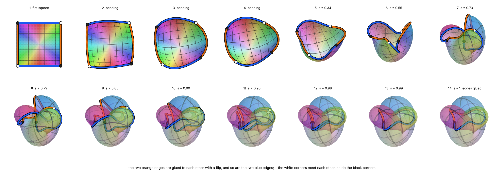

# From a square to Boy's surface

How a flat square, with its opposite edges glued with a flip, closes up into Boy's surface:
an immersion of the real projective plane ℝP² in ℝ³.



Animated version: [projective-plane-sequence.webp](projective-plane-sequence.webp).
Single frames: [`stages/`](stages/).

## What the pictures show

- **The square.** ℝP² is the square [−1, 1]² with each boundary point glued to the point opposite it
  through the centre, so opposite edges are glued with a flip. The two **orange** edges are glued to
  each other, as are the two **blue** edges. The **white** corners become one point, and so do the
  **black** corners.
- **Stages 1–4, bending.** The square bends into the small central cap of the surface. Fong's
  elliptical map takes the square onto the unit disk. It sends opposite boundary points of the
  square to opposite points of the circle, so the gluing rule carries over unchanged.
- **Stages 5–14, growing.** Each frame is the image of the parameter disk of radius *s* under the
  Bryant–Kusner parametrization (classic member, c = ½), so every frame is a genuine piece of
  Boy's surface. Only at *s* = 1 do opposite boundary points coincide: the two orange edges then run
  along the same closed curve, as do the two blue edges, and each pair of corners meets in a single
  point.
- **Colours.** Hue is twice the polar angle in the disk, so opposite points start with the same
  colour and the colouring stays continuous on the finished surface. The grid is the square's
  8 × 8 grid, carried along by the map.

The surface passes through itself: ℝP² has no embedding in ℝ³, only immersions. From stage 5 onward
the surface becomes semi-transparent so the self-intersections and the hidden edges stay visible.

## Regenerating

```
python projective_plane_sequence.py keys [out_dir]   # strip + stage_01..14.png
python projective_plane_sequence.py anim [out_dir]   # animated WebP
```

This is a standalone educational script; it needs `numpy`, `matplotlib` and `pillow`, which are
not project dependencies. Stage times, edge width, transparency and camera path are set near the
top and in the `keys` branch. It does not touch the game engine, the topology resolver, or any
runtime contract.
