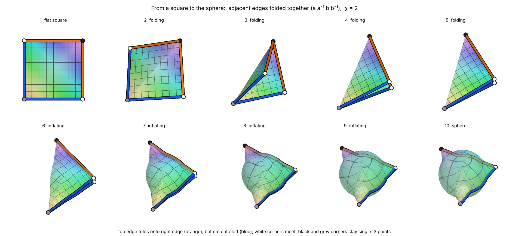

# From a square to the sphere

Animated version: [sphere-sequence.webp](sphere-sequence.webp). Single frames: [`stages/`](stages/).

**Gluing:** *a a⁻¹ b b⁻¹*. The top edge is glued to the right edge, and the bottom edge to the left
edge, each pair meeting at its shared corner like the flaps of an envelope.

**Corners:** the white corners meet; the black and grey corners each stay single.
That gives 3 points, so χ = 3 − 2 + 1 = 2.

**Stages:**
- **1–5, folding:** the square folds along its diagonal, so the top edge swings onto the right edge
  and the bottom edge onto the left.
- **6–10, inflating:** the folded envelope inflates into a sphere. Both layers of the envelope
  become hemispheres, and the glued edges become the seam between them. The 3 corner points stay
  as sharp cone tips: the square's corner angles do not flatten out, so they remain visible on the
  closed surface.

The result is a genuine embedding: the surface never passes through itself.

Generated by [`../surface-sequences/surface_sequences.py`](../surface-sequences/surface_sequences.py)
(`python surface_sequences.py sphere keys`). Conventions are described in the
[overview](../surface-sequences/README.md).
