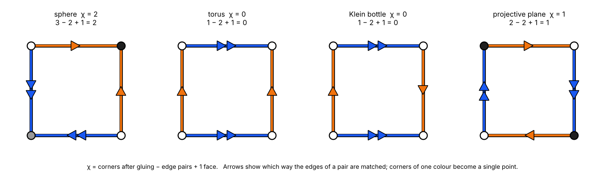

# Gluing a square into closed surfaces

One square, four gluing rules, four closed surfaces. Each sequence carries the square's grid, its
edges and its corners all the way to the finished surface, so you can watch which edges meet and
which corners become the same point.



| Surface | Gluing | Corners after gluing | χ | Sequence |
|---|---|---|---|---|
| Sphere | adjacent edges folded together (*a a⁻¹ b b⁻¹*) | 3 | 2 | [sphere-sequence](../sphere-sequence/README.md) |
| Torus | opposite edges straight (*a b a⁻¹ b⁻¹*) | 1 | 0 | [torus-sequence](../torus-sequence/README.md) |
| Klein bottle | one pair straight, one flipped (*a b a b⁻¹*) | 1 | 0 | [klein-bottle-sequence](../klein-bottle-sequence/README.md) |
| Projective plane | both pairs flipped (*a b a b*) | 2 | 1 | [projective-plane-sequence](../projective-plane-sequence/README.md) |

χ = corners after gluing − edge pairs + 1 face.

## Conventions

- **Edges:** the two orange edges are glued to each other, and so are the two blue edges. In the
  diagrams, arrows show which way a pair is matched (single arrow = orange pair, double = blue).
- **Corners:** corners of one colour (white / black / grey) become a single point.
- **Colours:** surface colours agree across every gluing, so a finished surface has no colour seam.
- **Transparency:** later stages turn semi-transparent so self-intersections and hidden edges stay
  visible.
- **In-between frames:** every frame is a continuous map of the square, not a cross-fade between
  pictures.

## Regenerating

```
python surface_sequences.py SURFACE keys [out_dir]   # captioned strip + stage_01..10.png
python surface_sequences.py SURFACE anim [out_dir]   # animated WebP
python surface_sequences.py overview [out_dir]       # gluing-diagrams.png
python surface_sequences.py check                    # numerical check of every gluing
```

`SURFACE` is one of `sphere`, `torus`, `klein-bottle`, `klein-figure8`, `projective-plane`.
`check` confirms, on the finished surfaces, that each edge lands on its partner with the right
orientation (mismatch at round-off level) and that corners merge into the expected number of points.

This is a standalone educational script. It needs `numpy`, `scipy`, `matplotlib` and `pillow`, which are not
project dependencies, and it does not touch the game engine, the topology resolver, or any runtime
contract. The 14-stage projective-plane images in `../projective-plane-sequence/` were made with that
folder's own script; this script's `projective-plane` mode makes a 10-stage version in the same style
as the others.
