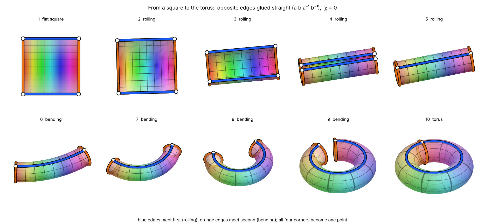

# From a square to the torus

Animated version: [torus-sequence.webp](torus-sequence.webp). Single frames: [`stages/`](stages/).

**Gluing:** *a b a⁻¹ b⁻¹*. Opposite edges are glued straight, with no flip.

**Corners:** all four become one point, so χ = 1 − 2 + 1 = 0.

**Stages:**
- **1–5, rolling:** the square rolls into a cylinder until the blue edges meet.
- **6–10, bending:** the cylinder bends into a ring until its two ends, the orange edges, meet.
  It stretches lengthwise as it bends, so the ring doesn't pinch shut at the centre.

The result is a genuine embedding: the surface never passes through itself.

Generated by [`../surface-sequences/surface_sequences.py`](../surface-sequences/surface_sequences.py)
(`python surface_sequences.py torus keys`). Conventions are described in the
[overview](../surface-sequences/README.md).
