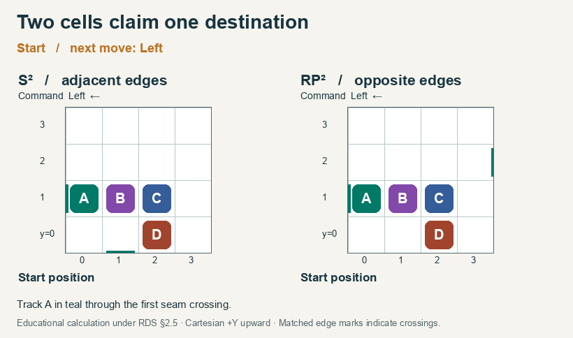
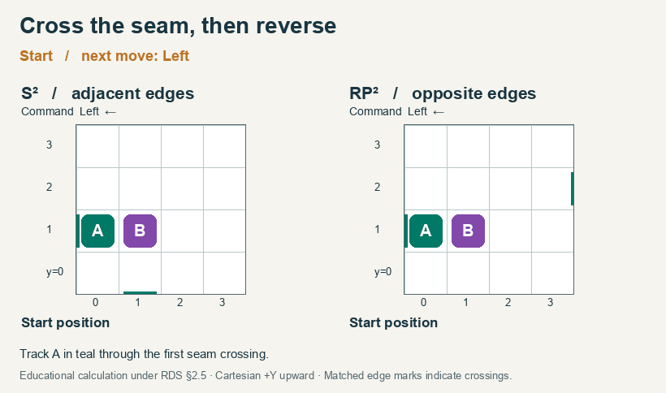
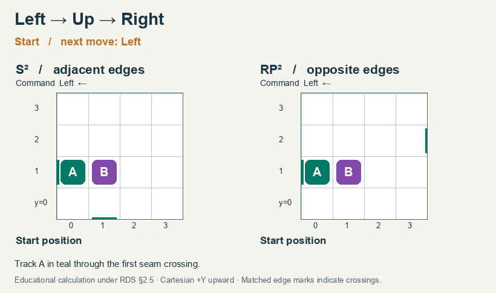
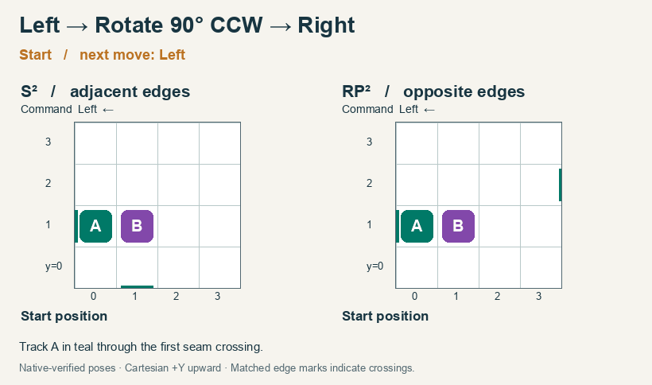

# Chapter 2 — Curvature, Seam Traversal, and Mercator Maps

**Gluings and Topologies: a computational introduction**
*Mathematical text and executable Python laboratory · 18 November 2026*

> **Central question.** Chapter 1 used edge identifications to construct topological surfaces from a square. Some of those surfaces—especially the sphere—cannot be everywhere flat. Why, then, can we still build them by gluing flat edges? What exactly goes wrong when an Explorer cell crosses a seam? And why is this closely related to the distortions of a Mercator world map?

**Prerequisite:** [Chapter 1 — Gluing Edges and Recognizing Topological Surfaces](../gluing-and-topologies/chapter_01_gluing_and_topologies.md). The chapter's four labelled corners and natural edge directions are retained here. The Python exercises are available separately in [this chapter's laboratory](README.md).

## 2.1 Four distinct mathematical objects

A picture of a surface displayed on a flat board does not uniquely specify its geometry. We must distinguish four layers.

1. **Quotient topology.** An equivalence relation $\sim$ specifies which boundary points are the same point in the constructed space, $Q/{\sim}$. The question is whether that quotient is topologically a sphere, torus, projective plane, or another space.
2. **Intrinsic metric.** A metric determines path lengths, angles, geodesics, and curvature **inside** the quotient surface. Two homeomorphic surfaces can have very different metrics.
3. **Coordinate presentation.** A chart labels neighbourhoods by planar coordinates. Charts may overlap and their transition rules may rotate, reflect, stretch, or deform the coordinate grid. A seam in a drawing can be a chart cut rather than a geometric break.
4. **Discrete movement.** A game or simulation defines an update rule for grid cells. That rule need not be a geodesic, a continuous map of the underlying surface, or a rigid motion.

A defect at one layer does not automatically imply a defect at another. In particular, a topologically correct sphere quotient can have a singular piecewise-flat metric and a perfectly well-defined—though non-rigid—cell-update rule.

## 2.2 Why a sphere cannot carry an everywhere-flat metric

Gaussian curvature $K$ measures intrinsic curvature: it can be determined by distances within a surface, without examining how the surface sits in an ambient three-dimensional space.

For a smooth compact surface without boundary, the Gauss–Bonnet theorem states

```math
\boxed{\int_M K\,dA=2\pi\chi(M).}
```

Here $\chi (M)$ is the Euler characteristic, which depends only on topology. This formula also applies to nonorientable closed surfaces when curvature is integrated as a density, or by passing to the orientable double cover. See the references in §2.12.

For a sphere $S^2$, $\chi =2$, so

```math
\int_{S^2}K\,dA=4\pi.
```

If an everywhere-flat metric existed, $K=0$ at every point; the integral would be zero, contradicting $4\pi$. Therefore **no smooth intrinsic metric on the whole sphere can be flat everywhere**.

The same obstruction applies to the real projective plane $\mathbb{RP}^2$, where $\chi =1$. But the torus and Klein bottle have $\chi =0$ and do admit flat intrinsic metrics.

| Closed surface | $\chi$ | Total curvature | Flat intrinsic metric? |
|---|---:|---:|---|
| Sphere $S^2$ | 2 | $4\pi$ | No |
| Projective plane $\mathbb{RP}^2$ | 1 | $2\pi$ | No |
| Torus $T^2$ | 0 | 0 | Yes |
| Klein bottle | 0 | 0 | Yes |

**Intrinsic versus extrinsic.** A conventional doughnut-shaped torus in Euclidean three-space has varying Gaussian curvature, yet an abstract torus formed by identifying opposite sides of a Euclidean rectangle is intrinsically flat. Its flat metric need not be realizable as a smooth isometric embedding in ordinary three-dimensional space. Similarly, the flat Klein bottle should not be confused with the familiar self-intersecting picture of it.

For a round sphere of radius $R$, $K=1/R^2$ everywhere and its area is $4\pi R^2$: the total curvature is $(1/R^2)(4\pi R^2)=4\pi$. Positive curvature is uniformly distributed in that particular metric. It need not be distributed uniformly for every metric on a sphere.

## 2.3 The single-square sphere concentrates curvature at three points

Chapter 1 introduced the square

```math
Q=[0,1]^2,\quad
A=(0,0),\ B=(1,0),\ C=(1,1),\ D=(0,1).
```

Its natural edge parameterizations are

```math
L(t)=(0,t),\quad R(t)=(1,t),\quad
B(t)=(t,0),\quad T(t)=(t,1).
```

Tet4D's normal single-domain $S^2$ construction identifies **adjacent** edges with positive tangent sign:

```math
\boxed{L(t)\sim B(t),\qquad R(t)\sim T(t).}
```

This is the repository's `sphere_adjacent_positive` construction, corresponding to `X−↔Y− +` and `X+↔Y+ +`. It is not the old `sphere_2d` negative-adjacent recipe, whose quotient is a Klein bottle. The current product requirements record this in [the Explorer topology RDS](../../../docs/rds/RDS_EXPLORER_TOPOLOGIES.md).

The positive-adjacent endpoint identifications give three quotient vertices:

```math
[A]=\{A\},\qquad [C]=\{C\},\qquad [BD]=\{B,D\}.
```

There is one quotient face and two quotient edges, so

```math
V=3,\quad E=2,\quad F=1,\qquad \chi=V-E+F=2.
```

Together with the valid vertex links and orientability established in Chapter 1, this identifies the quotient as $S^2$.

### A flat metric, except at cone points

Now retain the Euclidean metric inside the square. Its paired edges have equal length, so they can be joined by local **isometries**. Away from the original square corners, the resulting surface is locally a flat plane. At the quotient vertices, however, the total angle around a point is not necessarily $2\pi$.

For a quotient vertex $v$, define the *cone angle* and *angular defect* by

```math
\alpha(v)=\sum_{\text{corners identified at }v}\theta_{\text{corner}},
\qquad
\boxed{\delta(v)=2\pi-\alpha(v).}
```

Every original square corner contributes $\pi /2$. Thus:

| Quotient vertex | Original corners | Cone angle $\alpha$ | Defect $\delta$ |
|---|---|---|---|
| $[A]$ | $A$ | $\pi /2$ | $3\pi /2$ |
| $[BD]$ | $B,D$ | $\pi$ | $\pi$ |
| $[C]$ | $C$ | $\pi /2$ | $3\pi /2$ |
| **Total** | Four square corners | $2\pi$ | **$4\pi$** |

The discrete Gauss–Bonnet relation is satisfied exactly:

```math
\boxed{\sum_{v}\delta(v)=4\pi=2\pi\chi(S^2).}
```

**Where did the sphere's curvature go?** The square quotient is flat everywhere except at those three cone vertices. It has not defeated Gauss–Bonnet; it has concentrated the required total curvature at a finite set of points.

For an arbitrary *complete, valid* square-edge pairing, we always have one face and two quotient edges. If $V$ quotient vertices remain, the four right angles contribute $2\pi$ in total. Therefore

```math
\sum_v\delta(v)=2\pi V-2\pi
=2\pi(V-E+F)=2\pi\chi.
```

This elegant identity checks the curvature sum once the quotient is known to be a surface. It does **not** replace the vertex-link test: a quotient with a branching or disconnected vertex link need not be a manifold at all.

### Other examples

- A flat torus glues opposite edges without reversal. All four corners become one vertex with angle $4(\pi /2)=2\pi$; its angular defect is zero.
- A flat Klein bottle, with one opposite-edge pair reversed, likewise has one vertex of total angle $2\pi$. Its nonorientability is a **global** issue, not a local curvature singularity.
- The standard square projective plane reverses both opposite-edge pairs. It has two vertex classes, each containing two square corners. Each has angle $\pi$ and defect $\pi$, summing to $2\pi$.

**Resolution does not remove curvature.** Replacing an $8\times8$ square grid with $80\times80$ while keeping the same quotient and inherited flat metric creates more little flat cells but leaves the same three cone defects. Refinement alone does not turn this singular piecewise-flat sphere into a smooth round sphere.

## 2.4 What actually happens at a seam?

A seam joins two edges of the *coordinate representation*. It need not be a physical discontinuity of the surface.

For the sphere's first pairing,

```math
L(t)=(0,t)\sim B(t)=(t,0),
```

a convenient local unfolding from the neighbourhood of $L$ into that of $B$ is

```math
\boxed{S_{L\to B}(x,y)=(y,-x).}
```

For the second,

```math
R(t)=(1,t)\sim T(t)=(t,1),
```

one local unfolding is

```math
\boxed{S_{R\to T}(x,y)=(y,2-x).}
```

Both are affine Euclidean isometries. Their linear part is the quarter-turn

```math
J=
\begin{pmatrix}0&1\\-1&0\end{pmatrix},
\qquad J^TJ=I,\quad\det J=1.
```

Thus the seam can preserve intrinsic lengths and angles. But it changes the *coordinate components* of a direction.

For example,

```math
J\begin{pmatrix}-1\\0\end{pmatrix}
=\begin{pmatrix}0\\1\end{pmatrix}.
```

A vector pointing left on one side points upward in the other coordinate chart. This is what correctly transporting its local geometric direction through that particular seam looks like.

A repeated **fixed board-axis command** does something different: after crossing, the next command again refers to the displayed square's axes. It does not automatically use the transported frame.

The distinction is:

```math
\text{Transport direction through chart:}\quad v'\!=Jv
```

versus

```math
\text{Reapply a board command:}\quad a'\!=a.
```

These rules agree for some gluings and directions but not in general.

### Ordinary seams versus singular vertices

Along an ordinary interior point of a paired edge, two half-disc neighbourhoods join to form a Euclidean disc. Nothing singular happens geometrically. The drawn discontinuity is a coordinate cut.

At a cone point, the angle surrounding the point differs from $2\pi$. The point does not have an ordinary Euclidean metric neighbourhood. In the present sphere example all cone angles are below $2\pi$, so a locally shortest geodesic cannot pass *through* one of these positive-curvature cone apices in the usual manner.

There are thus two distinct issues: a perfectly regular seam can *look* discontinuous, while a cone vertex is a genuine singularity of the chosen metric.

## 2.5 Parallel transport, holonomy and the absence of global directions

A tangent vector at one point cannot simply be declared equal to a vector at a different point of a curved surface: their tangent planes are different. A geometric rule for comparing directions is needed.

For a Riemannian metric, the standard rule is **Levi-Civita parallel transport**. It preserves the length of a vector and its angle with other transported vectors. However, transporting a vector around a closed path may return it with a different orientation. This phenomenon is called *holonomy*.

On an oriented smooth surface, for a suitable simple closed loop bounding a disc $D$, the net rotation angle is

```math
\boxed{\Delta\theta=\int_D K\,dA\pmod{2\pi}}
```

up to the sign convention for traversing the loop.

For a round sphere of radius $R$,

```math
\Delta\theta=\frac{\operatorname{Area}(D)}{R^2}\pmod{2\pi}.
```

For a piecewise-flat cone surface, a loop surrounding one cone point picks up a rotation equal to the enclosed angular defect (modulo $2\pi$). Around our quotient vertex $[A]$, the magnitude is $3\pi /2$; around $[BD]$, it is $\pi$.

Individual seam transitions can therefore be locally isometric while a *sequence* of them has nontrivial global holonomy. This is not evidence of a bad gluing.

### Hairy-ball theorem

A related but distinct obstruction is the hairy-ball theorem: there is no continuous nowhere-zero tangent vector field on the whole $S^2$.

Consequently one cannot define one continuous global "rightward" tangent direction everywhere on the sphere, let alone a globally Euclidean pair of coordinate directions. Rotations of the round sphere do exist as global isometries; this theorem does not forbid moving objects on a sphere. It forbids **global flat translation directions** of the kind familiar from the plane.

### The nonorientable counterexample

The Klein bottle shows that nontrivial frame transport is not synonymous with curvature. Its flat metric has zero local Gaussian curvature, but a loop representing an orientation-reversing identification can return a transported frame **reflected**. The obstruction is global nonorientability, not local Gaussian curvature.

For the projective plane, both phenomena can occur: the topology is nonorientable *and* the Euler characteristic prevents an everywhere-flat smooth metric.

## 2.6 Why independently translated grid cells may split or deform

Tet4D's present 2D Explorer adopts a deliberate *free cellwise* movement rule. The [RDS §2.5](../../../docs/rds/RDS_EXPLORER_TOPOLOGIES.md) states that every cell receives the same canonical board-axis action, resolved independently by the native cell-step resolver. Transported frames are recorded but do not remap the next board-axis command. Different constituent cells may deform, change adjacency, or appear separated in the square.

### Predict a Left step on a $4\times4$ board

Use zero-based cell indices on a square of side $N=4$. As in Chapter 1, the mathematical figure uses Cartesian $+Y$ upward, with $y=0$ on the bottom row and Left equal to $(-1,0)$. The letters $B$ and $T$ name the bottom and top edges in that figure. In an Explorer screenshot, engine Up is $Y-$.

The sphere pairs L with B in the same parameter order. The selected projective plane pairs L with R in reverse order. On each board, where does Left send $(0,1)$? Where does it send $(2,0)$? Predict both destinations before reading on.

**Worked answer.** On the sphere, $(0,1)$ is one index up the left edge, so it arrives one index along the bottom at $(1,0)$. On the projective plane it arrives on the right at $(3,2)$, because reversing index $1$ gives $3-1=2$. The interior step from $(2,0)$ goes to $(1,0)$ on both boards.

**Exercise.** Join those two cells along the connected path $A=(0,1)$, $B=(1,1)$, $C=(2,1)$, $D=(2,0)$. Here A–D label individual cells. Predict all four destinations before deciding whether Left commits on either board.

**Worked answer.** The middle cells B and C stay in row 1 and move one column left on both boards.

| Board | A proposed | B proposed | C proposed | D proposed |
|---|---|---|---|---|
| Sphere | $(1,0)$ | $(0,1)$ | $(1,1)$ | $(1,0)$ |
| Selected projective plane | $(3,2)$ | $(0,1)$ | $(1,1)$ | $(1,0)$ |

A and D of the same piece compete for $(1,0)$ on the sphere, so the whole command rejects atomically. Every committed cell retains its source position. On the projective plane all four destinations are distinct, so the piece commits on an otherwise clear board, assuming a valid source state. All three original bonds survive. A and B meet across the reversed left–right seam, while B–C and C–D share ordinary grid edges.

<details>
<summary>Play the animation</summary>



</details>

*Educational calculation under [RDS §2.5](../../../docs/rds/RDS_EXPLORER_TOPOLOGIES.md#25-topology-first-amendment-named-2d-surfaces). Static transcript in A, B, C, D order.* Both boards start at $(0,1),(1,1),(2,1),(2,0)$. The proposal frame shows the table above. The sphere ends at the unchanged source pose. The projective plane commits $(3,2),(0,1),(1,1),(1,0)$.

### Derive the rule from the paired edges

For $x>0$, Left sends $(x,y)$ to $(x-1,y)$ for all three presentations below. For $x=0$, the index $y$ along L either stays in the same order or reverses to $N-1-y$. The target edge determines which coordinate carries that index. For $N\ge2$, interior sources already fill columns $0$ through $N-2$. Both adjacent-edge seam rules cover the bottom row and add just one previously unused target, $(N-1,0)$. The opposite-edge projective seam fills the entire last column.

| Presentation | Left from $(0,y)$ | Image size | $N=4$ | $N=8$ |
|---|---|---:|---:|---:|
| LB+ RT+ (sphere) | $(y,0)$ | $N(N-1)+1$ | 13 | 57 |
| LB− RT+ (adjacent-edge projective plane) | $(N-1-y,0)$ | $N(N-1)+1$ | 13 | 57 |
| LR− BT− (selected projective plane) | $(N-1,N-1-y)$ | $N^2$ | 16 | 64 |

Chapter 1's second projective presentation is a mathematical control. The product selector uses `sphere_adjacent_positive` for LB+ RT+ and `projective_2d` for LR− BT−. The legacy `sphere_collision` fixture refers to the separate `sphere_2d` profile.

Left fails to be injective over the whole square in the two adjacent-edge presentations. A particular piece can still move whenever its own proposed destinations are valid and distinct. For the selected projective presentation, Right is the cell-position inverse of Left. Right increments $x$ in the interior and takes $(N-1,y)$ to $(0,N-1-y)$ at the seam. These results describe the specified presentations and commands. Estimating deformation frequency would require a distribution over poses and commands.

### Three sequences from the same domino

[Lesson 03 extends this exercise to three square gluings](../seam-comparisons/chapter_03_seam_comparisons.md#worked-comparison--the-same-domino-on-a-b-and-c).

On both clear $4\times4$ boards, start with $A=(0,1)$ and $B=(1,1)$. First press Left. Both boards commit, and the original A–B bond survives across the paired edges. Use that post-Left pose for each sequence. Compare a direct Right step, Cartesian Up then Right, and a counterclockwise piece rotation then Right. Predict whether the original bond survives each sequence.

| Pose in A, B order | Sphere | Selected projective plane |
|---|---|---|
| Start | $(0,1),(1,1)$ | $(0,1),(1,1)$ |
| After Left | $(1,0),(0,1)$ | $(3,2),(0,1)$ |
| After Left, then Right | $(2,0),(1,1)$ | $(0,1),(1,1)$ |
| Left → Up | $(1,1),(0,2)$ | $(3,3),(0,2)$ |
| Left → Up → Right | $(2,1),(1,2)$ | $(0,0),(1,2)$ |
| Left → Rotate 90° counterclockwise | $(1,0),(2,0)$ | $(3,2),(3,3)$ |
| Left → Rotate 90° counterclockwise → Right | $(2,0),(3,0)$ | $(0,1),(0,0)$ |

**Worked answer, Left then Right.** On the sphere, A exits L at index 1 and enters B at the same index. The unfolding in §2.4 sends the outgoing command $a=(-1,0)$ to the arrival direction $Ja=(0,1)$. To reverse the crossing, step outward through B in direction $-Ja=(0,-1)$. This returns A from $(1,0)$ to $(0,1)$ and the reverse seam transforms its frame by $J^{-1}$. Board Right instead sends A from $(1,0)$ to $(2,0)$. The four neighbors of $(2,0)$ are $(1,0)$, $(3,0)$, $(2,1)$ and $(0,2)$, so B at $(1,1)$ is outside that set and the bond breaks. On the projective board Right sends both cells back to their start positions and the bond survives.

<details>
<summary>Play Left then Right</summary>



</details>

**Worked answer, Left → Up → Right.** Up means Cartesian $+Y$ in this figure. Both boards commit the Up step, and the original bond breaks. On the projective plane, the left–right seam joins $(3,3)$ to $(0,0)$, so the Up result $(3,3),(0,2)$ has no bond. Right takes the sphere cells to $(2,1),(1,2)$. On the projective board, A crosses R to L at reversed index 0 and B moves to $(1,2)$. The bond stays broken on both boards.

<details>
<summary>Play Left → Up → Right</summary>



</details>

**Worked answer, Left → Rotate 90° counterclockwise → Right.** The native solver develops the original domino in reference cell A's transported chart and uses A as the pivot in this example. On the sphere, the transported frame sends the material A–B direction to $(0,-1)$ in the developed chart. The Cartesian counterclockwise turn sends that vector to $(1,0)$ and places B one column right of A. On the projective board, the rotation places B one row above A. Both rotations commit with the bond intact. Right then moves both sphere cells inside the board. On the projective board, both cells cross R to L and reverse their row indices, keeping the bond.

<details>
<summary>Play Left → Rotate 90° counterclockwise → Right</summary>



</details>

The table is the static transcript. The first two clips illustrate the board-axis rule in RDS §2.5. The rotation clip shows committed poses verified through the native Explorer proposal and commit path. It jumps between the before and after rotation poses. Translation frames interpolate the center paths and mark paired edges. In the Cartesian figure, a counterclockwise rotation maps $(dx,dy)$ to $(-dy,dx)$ and uses native rotation direction −1. Cartesian Up uses board $Y+$ here. Explorer's screen Up uses $Y-$.

**Exercise.** Can a bijection of board positions break a quotient bond? On the selected projective board, $(1,0)$ and $(2,3)$ share an edge across the reversed B–T seam. Apply Left to both cells and check the resulting pair.

**Worked answer.** Left sends them to $(0,0)$ and $(1,3)$. The Right and $+Y$ steps from $(0,0)$ reach $(1,0)$ and $(0,1)$. The Left and $-Y$ steps both reach $(3,3)$ through different seams. None reaches $(1,3)$, so the original quotient bond breaks despite Left being bijective. At this corner the four directed steps have three distinct destinations.

**Rotation and Undo.** For a tangent frame, the reverse seam transform $J^{-1}$ cancels $J$. For a game rotation, the inverse question is whether applying the opposite turn to the resulting piece recovers the starting piece state. The [rotation contract](../../../docs/architecture/explorer_topology_piece_transport_contract.md#9-rotation-and-development-rules) develops the original piece geometry from a reference cell and walks across the surface. Near a cone point the walk can depend on its path, so the translation examples do not predict the outcome of a game rotation. Snapshot Undo restores the recorded semantic state, including positions, cell identities and frames. This is a separate inverse property from composing opposite board commands on positions.

### Back to the Explorer command

The [RDS §2.5 reference sequences](../../../docs/rds/RDS_EXPLORER_TOPOLOGIES.md#25-topology-first-amendment-named-2d-surfaces) give an $8\times8$ example in **engine coordinates**, where Up is $Y-$. Two successive engine Up commands give sphere $(2,0)\to(0,2)\to(0,1)$ and selected projective plane $(2,0)\to(5,7)\to(5,6)$. The first action crosses the seam. The second uses the same board axis and subtracts one from the new $y$ coordinate. The transported frame records the crossing without remapping that next action. These specification examples also appear by ID in the [transport fixture](../../../tests/fixtures/explorer_topology/transport_v1.json).

A simplified mathematical description is

```math
p_i'=T_a(p_i),
```

where $p_i$ is a cell's original board position and $T_a$ is the single-cell step operation for action $a$.

If some cells cross a seam and others do not, the representation of their updates can involve different local transitions:

```math
p_i'=
\begin{cases}
p_i+a,&\text{if this step stays inside the chart},\\
S_i(\text{continued local step}),&\text{if it crosses a seam}.
\end{cases}
```

This is a conceptual chart-level illustration, **not** a formula for the actual integer-grid resolver.

The coordinate-space distance $\lvert p_i'-p_j'\rvert$ displayed in the flat square need not equal its prior value. That observation alone tells us neither whether the cells are intrinsically separated nor whether a real rigid body deformed.

Section 2.9 summarizes how to diagnose these effects.

## 2.7 Mercator projection: preserving angles, sacrificing scale

The problem of representing a sphere in a plane has a long history in cartography. Mercator projection is especially revealing because it makes one deliberate geometrical choice: preserve local angles, not local distances or areas.

Let $R$ be the radius of a round sphere, $\lambda$ longitude, and $\phi$ latitude, with $-\pi /2<\phi <\pi /2$.

The round sphere's intrinsic line element in latitude–longitude coordinates is

```math
\boxed{ds^2=R^2\bigl(d\phi^2+\cos^2\phi\,d\lambda^2\bigr).}
```

The longitude coefficient shrinks toward the poles: a fixed longitude difference corresponds to a smaller east–west distance as the parallel of latitude contracts.

Mercator takes horizontal coordinate

```math
x=R\lambda
```

and chooses a vertical coordinate $y=y(\phi )$ so the east–west and north–south local scale factors match. The east–west map scaling is

```math
k_E=\frac{R\,d\lambda}{R\cos\phi\,d\lambda}=\sec\phi.
```

The north–south scaling is $k_N=y'(\phi)/R$. Conformality (equal local scale in orthogonal directions) requires

```math
y'(\phi)=R\sec\phi.
```

Integrating from the equator gives the spherical Mercator formula.

```math
\begin{aligned}
x &= R\lambda,\\
y &= R\int_0^\phi \sec u\,du \\
  &= R\ln(\sec\phi+\tan\phi) \\
  &= R\ln\tan\left(\frac{\pi}{4}+\frac{\phi}{2}\right).
\end{aligned}
```

The lower integration limit sets the equator at $y=0$. PROJ's [Mercator documentation](https://proj.org/en/stable/operations/projections/merc.html) describes this vertical coordinate as *isometric latitude*.

Differentiation gives

```math
dx=R\,d\lambda,\qquad dy=R\sec\phi\,d\phi,
```

hence

```math
\boxed{ds^2=\cos^2\phi\,(dx^2+dy^2).}
```

The factor multiplies both planar directions equally: Mercator is **conformal**. But that factor is not constant, so the map is not isometric.

The local map-to-ground scale and area scale are

```math
\boxed{k(\phi)=\sec\phi,\qquad k_{\rm area}(\phi)=\sec^2\phi.}
```

| Latitude | Linear scale | Area scale |
|---:|---:|---:|
| 0° | 1.00× | 1.00× |
| 30° | 1.15× | 1.33× |
| 60° | 2.00× | 4.00× |
| 80° | 5.76× | 33.16× |
| 85° | 11.47× | 131.65× |

These are **local differential** scale factors of the spherical Mercator projection; they are not exact ratios of lengths of arbitrary extended curves.

### Where are the poles?

As $\phi \to \pi /2$, $y\to +\infty$. As $\phi \to -\pi /2$, $y\to -\infty$. Both poles are omitted from the Mercator chart.

This is a **coordinate infinity**, not an infinite distance on the sphere. The meridional distance from the equator to a pole remains $\pi R/2$:

```math
\int_{0}^{+\infty}\cos\phi(y)\,dy
=
R\int_{0}^{\pi/2}d\phi
=
\frac{\pi R}{2}.
```

For the complete map with longitude made periodic, the coordinate domain has topology

```math
S^1\times\mathbb R
\cong S^2\setminus\{\text{north pole, south pole}\}.
```

This is an **open cylinder**, not a complete sphere. Closing the top edge by identifying it with the bottom edge would instead give a torus. To obtain the sphere topologically, each polar end must collapse to its own single point.

A discontinuity at the international date line in an ordinary printed Mercator map is a coordinate cut. Its existence is independent of the genuine scale divergence toward the poles.

## 2.8 The same sphere, represented in two radically different ways

The Mercator construction and the single-square quotient can describe homeomorphic surfaces, but they put their geometrical difficulty in different places.

| Property | Mercator on a round sphere | Tet4D one-square $S^2$ quotient |
|---|---|---|
| Underlying topology when completed | Sphere | Sphere |
| Metric | Round spherical metric | Euclidean metric in the square, completed as a cone metric |
| Curvature | Smooth, $K=1/R^2$ | Zero off three cone vertices |
| Total curvature | $4\pi$ | $4\pi$ |
| Main coordinate issue | Scale grows without bound near omitted poles | Glued-edge cuts and sharply concentrated cone curvature |
| Locally angle-preserving? | Yes, between chart and round sphere | Yes at regular seams through isometric unfolding |
| What cannot be removed? | Nonzero total intrinsic curvature | Nonzero total intrinsic curvature |

On the round sphere, curvature is uniform and Mercator scale varies with latitude. On the Euclidean square quotient, curvature is concentrated at three cone points.

### Why multiple charts matter

A sphere has no single globally regular coordinate chart covering every point. A mathematical atlas uses overlapping charts and transition maps, so the neighbourhood of a pole or a seam can be described in coordinates that remain regular there.

Switching from Mercator to a stereographic chart near a pole gives that neighbourhood finite coordinates. Gaussian curvature is an intrinsic scalar of the metric. A chart change re-expresses the same metric and preserves the curvature at every point covered by both charts.

A multi-chart Explorer could show a seam crossing as continuous in one chart and discontinuous in another while keeping the same quotient.

### Interactive Earth demonstration

Get the repository checkout and open `learning/tutorials/curvature-seams-and-mercator/interactive-earth/index.html` in a browser. Keep the adjacent JavaScript, CSS and generated land mask together. The [HTML link](interactive-earth/index.html) on GitHub shows the source. The [demo guide and dataset attribution](interactive-earth/README.md) explain the controls and two-triangle projection. Dragging rotates the geography under the fixed pairings $L(t)\sim B(t)$ and $R(t)\sim T(t)$.

## 2.9 A mathematical diagnostic framework for Explorer

A robust analysis labels each property by the layer to which it belongs. It must not silently reject a mathematically valid sphere because a flat-board piece appears to deform.

| Diagnostic | Mathematical test | What it decides |
|---|---|---|
| Quotient correctness | Reciprocal edge maps, endpoint classes | Which points are identified |
| Manifold correctness | Vertex-link circles or intervals | Whether local neighbourhoods are surface-like |
| Topological class | $\chi$, boundary count, orientability | Which compact surface results |
| Metric consistency | Isometry of seam parameter maps | Whether the chosen flat metric extends across regular seams |
| Singular curvature | Cone angle defects | Where intrinsic piecewise-flat curvature lives |
| Curvature accounting | $\sum\delta=2\pi\chi$ | Consistency with Gauss–Bonnet |
| Direction transport | Partner edge, tangent index, $J$ and $J^{-1}$ | Arrival and return directions at a regular seam |
| Metric holonomy | Compose frame transports around a loop | Net change in orientation |
| Board-axis translation | Apply the same board command to every cell | Which coordinates each cell proposes |
| Move admission | Validate the source and destinations, then check distinctness within the piece | Whether all proposals commit atomically |
| Global injectivity | Count the image over all possible source cells | Whether two sources can share a target under this command |
| Position inverse | Compose opposite board commands over the cell positions | Whether every position is recovered |
| Game rotation | Apply the rotation contract to the piece, then test the opposite turn | Whether the turned piece recovers its original state |
| Snapshot Undo | Compare the restored semantic state against the recorded source | Whether coordinates, identities and frames are recovered |
| Piece bonds | Check reciprocal four-neighbor relations by cell identity | Which original bonds survive a committed action |
| Visual presentation | Chart cuts, projection and overlays | Whether apparent gaps imply intrinsic gaps |

For the repository's current named examples, the invariant target values are

```math
\begin{array}{c|cc}
\text{Surface} & \chi & \sum\delta\\ \hline
S^2 & 2 & 4\pi\\
\mathbb{RP}^2 & 1 & 2\pi\\
T^2 & 0 & 0\\
\text{Klein bottle} & 0 & 0
\end{array}
```

These geometric computations supplement, rather than replace, the existing independent quotient classification and vertex-link tests.

### Research implication

If a user cannot predict the visual location of a cell after crossing a seam, it is important to distinguish three explanations:

1. The user has not learned the **topological pairing**.
2. The user understands the pairing but has not learned the **coordinate-frame change**.
3. The user understands both but expects the **discrete piece movement** to preserve a geometric property the game does not impose.

Those are different kinds of spatial reasoning. Conflating them would make it difficult to study what Tet4D users actually learn.

## 2.10 The Python laboratory

The source files for this chapter are [curvature_mercator_lab.py](curvature_mercator_lab.py) and [test_curvature_mercator_lab.py](test_curvature_mercator_lab.py). They require only Python's standard library and do **not** import the Tet4D engine.

The first calculation starts with exactly the edge endpoint maps defined in Chapter 1. Its function `vertex_classes` uses union-find to identify square corners. It then computes

```math
\delta([v])=2\pi-\frac{\pi}{2}\,|\,[v]\,|.
```

The following abbreviated calls illustrate the laboratory:

~~~python
from math import pi, radians
from curvature_mercator_lab import (
    SURFACES,
    vertex_classes,
    cone_defects,
    quotient_summary,
    sphere_seam_vector,
    mercator_y,
    mercator_scale,
)

print(vertex_classes(SURFACES["sphere"]))
# (('A',), ('B', 'D'), ('C',))

chi, total_defect = quotient_summary(SURFACES["sphere"])
assert chi == 2
assert abs(total_defect - 4 * pi) < 1e-12

print(sphere_seam_vector(-1, 0))  # (0, 1)
print(mercator_scale(radians(60)))  # approximately 2
print(mercator_y(radians(80)))  # finite, but rapidly increasing
~~~

The seam illustration implements the two affine unfoldings from §2.4; its vector function returns the associated Jacobian action. This is **not** a substitute for Tet4D's native cell-step resolver.

The lab evaluates the algebraically equivalent northing $R\operatorname{asinh}(\tan\phi)$. Near the north pole the addition in $\pi/4+\phi/2$ can round to $\pi/2$. Near the south pole the subtraction suffers cancellation, leaving a small residual sensitive to rounding. Evaluating $\tan\phi$ directly avoids forming the shifted angle and preserves odd symmetry to floating-point precision. The exact poles remain outside the domain.

Run the examples and 20 regression tests from the repository root:

~~~sh
PY="$(./scripts/resolve_python_env.sh)"
"$PY" learning/tutorials/curvature-seams-and-mercator/curvature_mercator_lab.py
"$PY" -m unittest discover \
  -s learning/tutorials/curvature-seams-and-mercator \
  -p 'test_curvature_mercator_lab.py' -v
~~~

The laboratory verifies vertex classes, all four curvature totals, the flat torus/Klein metrics, seam endpoint correspondence and norm preservation, Left image sizes and the selected projective inverse, the four animation traces, Mercator scaling and near-pole symmetry, exact pole exclusion and malformed input rejection. Its four named pairings are known surface examples; for **general** user-authored gluing specifications the program would still need an independent vertex-link/manifold validator before interpreting angular defects as surface curvature.

## 2.11 Exercises

1. **Cones and vertices.** Compute the angle defects for the standard square $\mathbb{RP}^2$ gluing and explain why its total must be $2\pi$. Then compute the same quantity for the torus.
2. **Inverse crossing.** Invert the coordinate map $(x',y')=(y,-x)$. Check explicitly that its Jacobian preserves squared vector norms and has determinant $+1$.
3. **Holonomy.** A loop encloses exactly the $[BD]$ cone point of our square sphere. Predict the rotation accumulated by parallel transport, modulo $2\pi$.
4. **Mercator scale.** Derive $dy/d\phi=R\sec\phi$ from the formula for $y$, and verify why the local map area scale is the square of its length scale.
5. **A finite journey to infinity.** Evaluate the meridional ground distance represented by $y\in [0,+\infty )$, using $ds=\cos\phi\,dy$.
6. **Classification of a visual failure.** Give one example each of an apparent chart discontinuity, a genuine cone singularity, and a non-injective discrete cell move. Explain which one is a topology error, if any.
7. **Study design.** Propose a learning task that isolates the understanding of *edge adjacency* from the understanding of *transported direction*.

## 2.12 References and boundaries of this chapter

- [Tet4D Explorer topology requirements](../../../docs/rds/RDS_EXPLORER_TOPOLOGIES.md), especially §2.5, for the chosen positive-adjacent sphere and authoritative free-cellwise movement rule.
- [Tet4D topology certification contract](../../../docs/architecture/explorer_topology_catalog_certification_contract.md) for the exact one-square quotient evidence procedure and mathematical versus runtime status.
- [MathWorld — Gauss–Bonnet Formula](https://mathworld.wolfram.com/Gauss-BonnetFormula.html), for the smooth curvature theorem.
- [Oregon State University — Gauss–Bonnet](https://sites.science.oregonstate.edu/physics/coursewikis/GDF/book/content/gaussbonnet.html), for the relation between angle defects and Euler characteristic.
- [PROJ — Mercator projection](https://proj.org/en/stable/operations/projections/merc.html), for isometric latitude and projection definitions.
- [Snyder, *Map Projections: A Working Manual*, Mercator section](https://neacsu.net/geodesy/snyder/3-cylindrical/sect_7/), for spherical map-scale formulas.

The chapter is an **educational mathematical exposition**, not a new topology certification or movement specification. It does not redefine the native solver's action semantics, promote any experimental surface, or imply that visual discontinuity requires repair. The core lesson is that **topological identification, intrinsic curvature, coordinate representation and discrete movement are separate structures**: a correct quotient does not make them interchangeable.
