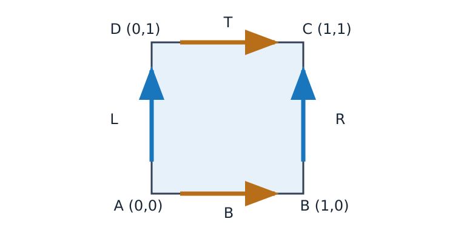

# Chapter 1 — Gluing Edges and Recognizing Topological Surfaces

**Gluings and Topologies: a computational introduction**
*Mathematical text and executable Python laboratory · 18 November 2026*

> **Scope.** We begin with one closed square and identify its boundary edges in pairs. We distinguish raw gluing descriptions, descriptions equivalent under square symmetry, and quotient surfaces equivalent up to homeomorphism. The Python laboratory reproduces every count and checks the local quotient structure. The final section relates the construction to Tet4D's Explorer, without conflating the continuous quotient with discrete piece movement.

## 1.1 The construction: a quotient of a square

Let \(Q=[0,1]^2\). A gluing declares that a point on one boundary edge is the *same point of the quotient space* as a specified point on another boundary edge. Symbolically, for an equivalence relation \(\sim\), the resulting space is \(Q/\sim\).

Label the corners \(A=(0,0)\), \(B=(1,0)\), \(C=(1,1)\), and \(D=(0,1)\). Name the edges **L** (left), **R** (right), **B** (bottom), and **T** (top). We parameterize them in their increasing coordinate direction:

| Edge | Parameterization, \(0\le t\le1\) | Endpoints |
|---|---|---|
| L | \((0,t)\) | A → D |
| R | \((1,t)\) | B → C |
| B | \((t,0)\) | A → B |
| T | \((t,1)\) | D → C |



**A gluing has two choices.** First select *which edges* are paired. Then choose whether their parameter coordinates are matched or reversed. Our notation is `LR+` for \(L(t)\sim R(t)\), and `LR-` for \(L(t)\sim R(1-t)\). Thus `+` and `-` are **relative to the edge parameterizations in the table**, not to arrows drawn counterclockwise around the square. This distinction is essential: a square symmetry can change a gluing's displayed sign.

Some edges may remain free. Their interiors form boundary points of the resulting surface. A **complete gluing** pairs all four edges; a **partial gluing** leaves at least one edge free.

### From construction to identity

Do not confuse three equivalence relations:

1. **Syntactic identity.** Pair order, reciprocal descriptions, and other purely notational differences have been normalized.
2. **Square-symmetry equivalence.** One configuration is obtained from another by rotating or reflecting the *original square* (the action of \(D_4\)).
3. **Topological equivalence.** The quotient spaces are homeomorphic. This relation is coarser; it can relate polygon presentations that no symmetry of the square connects.

The chain of counts for complete square gluings will be **12 → 6 → 4**. The three arrows represent enumeration, geometric symmetry reduction, and classification of the resulting surfaces.

## 1.2 Count the raw configurations

There are three perfect matchings of four labelled edges:

- Opposite pairs: `(L,R)` and `(B,T)`;
- Adjacent pairs: `(L,B)` and `(R,T)`;
- Other adjacent pairs: `(L,T)` and `(R,B)`.

Each of the two pairs has two possible tangent signs. Consequently the complete count is

\[
3\cdot2^2=12.
\]

If edges may remain unglued, the possibilities are zero pairs, one pair, or two pairs:

\[
1+\binom{4}{2}\cdot2+3\cdot2^2=1+12+12=25.
\]

These are counts of **disjoint edge-pairing descriptions**. They are not counts of topological surfaces.

## 1.3 The dihedral group \(D_4\)

The symmetry group of a square has eight elements: identity, three nontrivial rotations, and four reflections. Its order is \(|D_4|=8\). A symmetry \(g\) sends each edge to another edge, but it may also reverse that edge's natural parameter direction.

Let \(\varepsilon_e(g)\in\{+1,-1\}\) record whether the parameter direction of edge \(e\) is preserved under \(g\). If edges \(a,b\) have gluing sign \(s\), then their transformed gluing sign is

\[
\boxed{s'=\varepsilon_a(g)\,s\,\varepsilon_b(g).}
\]

This follows by conjugating the original coordinate correspondence by the two edge-parameter transformations. It is insufficient to rename `L`, `R`, `B`, `T`: their parameter directions must be transformed as well. Because \(s=\pm1\), reversing the source/target description of a pair does not change the sign.

**Concrete example.** Reflect the square across its vertical centreline. The configuration `LB+, RT+` becomes `LT-, RB-`. The pairings and signs appear different, but the quotient construction is carried to the other by a rigid symmetry of the square. Conversely, `LB+, RT+` and `LR+, BT+` both yield orientable closed surfaces, but they are *not* symmetry-equivalent (one yields a sphere and the other a torus).

The **orbit** of a gluing \(G\) is \(D_4\cdot G=\{g\cdot G:g\in D_4\}\). An orbit collects all descriptions of the same gluing construction obtainable by square symmetry. A canonical representative is any deterministic minimum of the orbit, after serialization.

### The six symmetry orbits

The following table uses a representative of each orbit. Its sizes sum to twelve.

| Representative | Orbit size | Quotient surface |
|---|---:|---|
| `LR+, BT+` | 1 | Torus |
| `LR-, BT+` | 2 | Klein bottle |
| `LR-, BT-` | 1 | Projective plane |
| `LB+, RT+` | 2 | Sphere |
| `LB-, RT-` | 2 | Klein bottle |
| `LB-, RT+` | 4 | Projective plane |
| **Total** | **12** | **6 symmetry classes, 4 surface classes** |

Thus the symmetry reduction is \(12\to6\), but it is **not** obtained by dividing by eight: some configurations have nontrivial stabilizers.

## 1.4 Burnside's lemma proves the orbit count

For a finite group acting on a finite set, Burnside's lemma gives

\[
\left|X/D_4\right|=\frac{1}{8}\sum_{g\in D_4}|\mathrm{Fix}(g)|,
\]

where \(\mathrm{Fix}(g)\) means configurations left unchanged by \(g\). The eight counts for the 12 complete gluings are:

| Symmetry | Fixed configurations |
|---|---:|
| Identity | 12 |
| Rotations 90° / 270° | 2 each |
| Rotation 180° | 8 |
| Reflections horizontal / vertical | 4 each |
| Reflections in either diagonal | 8 each |
| **Total over all eight elements** | **48** |

Therefore \(48/8=6\). For all 25 partial and complete gluings, the corresponding fixed counts sum to 88, so there are \(88/8=11\) symmetry orbits.

Burnside's lemma is a cross-check on the explicit orbit enumeration. The software implements both methods and asserts they agree.

## 1.5 From an edge diagram to a topological surface

The quotient topology cannot be read solely from the signs or the number of pairs. We must calculate what the identifications do to vertices, edges and local neighbourhoods.

### Step 1 — Identify the corners

Each gluing creates endpoint identifications. `LR+` identifies A with B and D with C, while `LR-` identifies A with C and D with B. We take the transitive closure of all such identifications; this is a standard **disjoint-set union / union-find** problem.

### Step 2 — Count cells and compute Euler characteristic

For a square with \(m\) edge pairs, there is one face and \(4-m\) quotient edges. If \(V\) is the number of corner equivalence classes,

\[
F=1,\qquad E=4-m,\qquad \chi=V-E+F.
\]

For a complete gluing, \(m=2\), and hence \(\chi=V-1\).

### Step 3 — Check orientability

Traverse the original square boundary counterclockwise. Relative to our natural edge parameters, its directed edge signs are

\[
o(B)=+1,\quad o(R)=+1,\quad o(T)=-1,\quad o(L)=-1.
\]

For a single oriented face, a paired edge must be attached with *opposing induced boundary orientations*. Thus every pair \((a,b,s)\) must satisfy

\[
\boxed{o(a)\,s\,o(b)=-1.}
\]

Failure for even one pair makes this single-square quotient nonorientable. For a complex assembled from multiple faces, the test becomes a system of consistent face-orientation constraints, rather than checking every pair independently.

### Step 4 — Identify boundary components and validate local links

Edges that were never paired supply boundary segments. But counting free edges is not the same as counting boundary components; endpoint identifications can join several segments into one cycle.

There is a further logical requirement: **the quotient must actually be a surface.** At each quotient vertex, the *link*—an infinitesimal cross-section of the neighbourhood—must be one circle for an interior point, or one interval for a boundary point. Disconnected or branching links signal a singular quotient that the surface classification theorem does not cover.

The laboratory constructs this link graph from corner arcs and gluing-induced identifications of edge-endpoint germs. It rejects disconnected or branching links rather than relying on Euler characteristic alone.

### Step 5 — Apply the classification theorem

For a compact connected surface with \(b\) boundary components, genus \(g\) in the orientable case, and crosscap number \(k\) in the nonorientable case, we have

\[
\chi=2-2g-b,
\]

\[
\chi=2-k-b.
\]

For complete square gluings, \(b=0\), giving the table:

| \(V\) | \(\chi\) | Orientable? | Surface |
|---:|---:|---|---|
| 3 | 2 | Yes | Sphere \(S^2\) |
| 2 | 1 | No | Projective plane \(\mathbb{RP}^2\) |
| 1 | 0 | Yes | Torus \(T^2\) |
| 1 | 0 | No | Klein bottle |

No other surface classes occur in these 12 complete square gluings.

## 1.6 Two detailed examples

### Example A: the torus

Start from `LR+, BT+`. The first pairing gives \(A\sim B\), \(D\sim C\); the second gives \(A\sim D\), \(B\sim C\). Together, all four vertices are equivalent. Therefore \(V=1,E=2,F=1,\chi=0\). Both identifications reverse counterclockwise boundary traversal, so the quotient is orientable. With no boundary, \(0=2-2g\) implies \(g=1\): the **torus**.

### Example B: a sphere and a misleading “sphere-like” rule

For `LB+, RT+`, the first pairing has endpoint identifications \(A\sim A\) and \(D\sim B\); the second adds \(B\sim D\) and \(C\sim C\). We obtain three vertex classes \(\{A\},\{B,D\},\{C\}\). Consequently \(\chi=3-2+1=2\), and the quotient is orientable: **the sphere**.

Now change both signs to `LB-, RT-`. The induced endpoint identifications connect all four vertices. We obtain \(V=1,\chi=0\), and the orientation test fails: **the Klein bottle**, not a sphere. This distinction appears in Tet4D's topology certification contract, which separates the old negative-adjacent *sphere-like transport* recipe from the positive-adjacent genuine sphere quotient.

## 1.7 The complete distribution

If all edges are glued, the 12 raw configurations distribute as follows:

| Surface | Raw configurations | Symmetry classes |
|---|---:|---:|
| Sphere | 2 | 1 |
| Torus | 1 | 1 |
| Klein bottle | 4 | 2 |
| Projective plane | 5 | 2 |
| **Total** | **12** | **6** |

If free edges are allowed, the 25 raw configurations represent seven surfaces:

| Surface | Raw configurations |
|---|---:|
| Disk | 5 |
| Cylinder / annulus | 2 |
| Möbius strip | 6 |
| Sphere | 2 |
| Torus | 1 |
| Klein bottle | 4 |
| Projective plane | 5 |
| **Total** | **25** |

The difference between six square-symmetry classes and four closed-surface classes is a basic lesson: **homeomorphism is not the same as symmetry of a chosen polygonal presentation**. Two different polygonal schemata can produce the same topological space.

## 1.8 Python laboratory: design and execution

The accompanying source files are written for **Python 3.10 or later** and use only the standard library:

| File | Purpose |
|---|---|
| `square_gluings.py` | Common mathematical engine: pairings, \(D_4\) action, orbit enumeration, union-find, link checks and surface invariants |
| `01_enumerate.py` | Enumerate all 12 complete and all 25 partial/complete configurations |
| `02_d4_orbits.py` | Compute the six/eleven symmetry orbits and verify Burnside's fixed-point counts |
| `03_classify.py` | Derive \(V,E,F,\chi\), boundary components and orientability for orbit representatives |
| `test_square_gluings.py` | Regression tests for the enumeration, examples and invariance under symmetry |

Place the five files in one directory. In a shell run:

```bash
python 01_enumerate.py
python 02_d4_orbits.py
python 03_classify.py
python -m unittest -v test_square_gluings
```

The principal expected output is:

```text
12 gluings -> 6 D4 orbits
25 gluings -> 11 D4 orbits
identity                : 12   # complete case
rotate 180°             : 8
...
Klein bottle             : 4 raw gluings
projective plane (RP²)   : 5 raw gluings
sphere                   : 2 raw gluings
torus                    : 1 raw gluings
Ran 8 tests ... OK
```

### 1.8.1 Why the enumerator is exhaustive

`all_gluings()` recursively selects the first available edge, then either leaves it free (in partial mode) or pairs it with one of the remaining edges. For every resulting matching, `itertools.product((-1, 1), ...)` assigns all gluing signs. Normalization and a Python `set` remove redundant orders. The recursion therefore visits each legal disjoint matching, and nothing else.

### 1.8.2 How the program applies \(D_4\)

A square symmetry is represented by a permutation of the two coordinates and an independent sign flip along either output coordinate. There are \(2!\cdot2^2=8\) such maps. `mapped_edge()` transports both endpoints of a directed edge to determine the destination edge and whether its natural parameter has reversed. `transform()` applies the formula \(s'=\varepsilon_a s\varepsilon_b\). `orbit()` takes all eight images; `orbits()` partitions the enumeration by these images. `02_d4_orbits.py` independently checks the fixed-point sum from Burnside's lemma.

### 1.8.3 How union-find and the link checker work

`vertex_classes()` unions the original corner endpoints forced together by every pair; the quotient-vertex count is the number of connected components. `validate_vertex_links()` creates a short arc for the infinitesimal link at each original corner, then identifies arc endpoints along glued edges. The resulting graph must be one circle (degree 2 at every node) or one interval (two degree-1 ends, all other degrees 2), and must be connected. `boundary_components()` joins the endpoints of unpaired edges *after* vertex identification to count boundary loops. Finally `classify()` applies Euler characteristic and surface classification formulas.

**Limits of the implementation.** The code is an exact finite combinatorial laboratory for one square with disjoint whole-edge pairs and affine \(t\mapsto t\) or \(t\mapsto1-t\) gluing maps. It does not classify arbitrary nonmanifold quotient specifications, nontrivial subdivisions, several-face complexes, non-Euclidean maps, or higher-dimensional manifolds. It validates the vertex links for its own square model; it is not a general-purpose topology prover.

## 1.9 What generalizes to cubes and tesseracts?

An \(n\)-cube has \(2n\) codimension-one faces and hyperoctahedral symmetry group \(B_n\) of size \(2^n n!\). For a cube, the six square faces may be paired in 15 ways, and each paired face admits eight square symmetries: \(15\cdot8^3=7,680\) full descriptions. For a tesseract, there are eight cubic hyperfaces, 105 perfect matchings, and 48 cube-symmetry gluing maps per pair: \(105\cdot48^4=557,383,680\) full descriptions. These are **raw descriptions**, not manifolds or symmetry classes.

| Ambient cell | Boundary elements | Symmetries of the cell | Gluing maps per paired boundary element |
|---|---:|---:|---:|
| Square (2D) | 4 edges | 8 | 2 |
| Cube (3D) | 6 faces | 48 | 8 |
| Tesseract (4D) | 8 hyperfaces | 384 | 48 |

The orbit-canonicalization idea generalizes directly: enumerate each ambient symmetry, transform the gluing data, then choose the least normalized encoding. **Surface classification does not generalize directly**: in dimensions 3 and 4, Euler characteristic and orientability alone do not identify a manifold. Links must be checked in the appropriate dimension, and stronger invariants (for example fundamental groups and homology) are necessary; even these may not uniquely classify spaces.

For Tet4D's Explorer, keep separate (i) a continuous topological quotient, (ii) its discrete lattice step-resolver, and (iii) the behavior of potentially deforming multi-cell pieces crossing seams. A correct surface classification does not by itself prove that a particular piece transport rule implements it faithfully.

## 1.10 Exercises

1. Derive the formula \(1+6\cdot2+3\cdot4=25\) without writing code.
2. Write the eight \(D_4\) transformations as maps \((x,y)\mapsto(x',y')\) and verify that they are closed under composition.
3. Starting with `LR+, BT-`, calculate the image under a diagonal reflection and explain why it becomes the opposite one-flip configuration.
4. Derive the corner equivalence classes for `LR-, BT-` and identify its surface.
5. Remove `validate_vertex_links()` and construct, using two or more polygons joined at one vertex, a quotient for which Euler characteristic alone would mislead.
6. Extend the canonicalization code to report stabilizer size; verify the orbit-stabilizer equation \(|D_4\cdot G|=8/|\mathrm{Stab}(G)|\).

## 1.11 References and reproducibility

- Jeff Erickson, [Surface Classification](https://jeffe.cs.illinois.edu/teaching/comptop/2020/notes/20-surface-classification.html) and [Surface Maps](https://jeffe.cs.illinois.edu/teaching/comptop/2023/notes/19-surface-maps.html). Background on polygonal surface maps, orientability and classification.
- Romyar Sharifi, [Advanced Group Theory: group actions and Burnside's formula](https://math.ucla.edu/~sharifi/notes/algebra-ch04.html).
- Tet4D repository, [Explorer topology catalog and certification contract](https://github.com/mousomer/tet4d/blob/master/docs/architecture/explorer_topology_catalog_certification_contract.md). Project-specific square recipes and quotient evidence.

**Reproducibility statement.** The supplied scripts independently reproduce the displayed 12/25 gluing counts, 6/11 symmetry-orbit counts, Burnside fixed-point sums, the four/seven topological classes, and the Tet4D negative-adjacent/Klein versus positive-adjacent/sphere distinction. The unit tests were run before publication.


# Appendix A — Complete executable Python source

All code listings below are complete copies of the companion files. Run them as separate files in the same directory.

## A.1 `square_gluings.py`

```python
"""Enumerate square edge gluings and classify their compact quotient surfaces.

Python >= 3.10; no third-party dependencies.

Each edge is parameterized naturally as follows:
  L: (0,0) -> (0,1)
  R: (1,0) -> (1,1)
  B: (0,0) -> (1,0)
  T: (0,1) -> (1,1)
A sign of +1 matches first endpoints and last endpoints.
A sign of -1 swaps them.
"""

from __future__ import annotations

from dataclasses import dataclass
from itertools import combinations, permutations, product

Point = tuple[int, int]
EDGE_ENDS: dict[str, tuple[Point, Point]] = {
    "L": ((0, 0), (0, 1)),
    "R": ((1, 0), (1, 1)),
    "B": ((0, 0), (1, 0)),
    "T": ((0, 1), (1, 1)),
}
EDGE_ORDER = "LRBT"
EDGE_INDEX = {name: index for index, name in enumerate(EDGE_ORDER)}


@dataclass(frozen=True, order=True)
class Pair:
    """A paired edge pair (first < second by EDGE_ORDER) and tangent sign."""

    first: str
    second: str
    sign: int

    def __post_init__(self) -> None:
        if EDGE_INDEX[self.first] >= EDGE_INDEX[self.second]:
            raise ValueError("Pair edges must be in canonical order")
        if self.sign not in (-1, 1):
            raise ValueError("Gluing sign must be +1 or -1")


# A gluing is a tuple of disjoint edge pairs; any unmentioned edge is left free.
Gluing = tuple[Pair, ...]


def normalize(pairs: list[tuple[str, str, int]]) -> Gluing:
    """Canonical order, irrespective of how a pair was described."""
    normalized: list[Pair] = []
    used: set[str] = set()
    for a, b, sign in pairs:
        if a == b or a not in EDGE_ENDS or b not in EDGE_ENDS:
            raise ValueError("Each pair must consist of distinct known edges")
        if a in used or b in used:
            raise ValueError("An edge cannot occur in two gluing pairs")
        used.update((a, b))
        if EDGE_INDEX[a] > EDGE_INDEX[b]:
            a, b = b, a
        normalized.append(Pair(a, b, sign))
    return tuple(
        sorted(normalized, key=lambda p: (EDGE_INDEX[p.first], EDGE_INDEX[p.second]))
    )


def all_gluings(complete: bool = True) -> list[Gluing]:
    """Generate 12 complete pairings, or all 25 including free edges."""

    def matchings(edges: tuple[str, ...]):
        if not edges:
            yield ()
            return
        first, rest = edges[0], edges[1:]
        if not complete:
            for tail in matchings(rest):
                yield tail
        for other in rest:
            remaining = tuple(e for e in rest if e != other)
            for tail in matchings(remaining):
                yield ((first, other),) + tail

    result: set[Gluing] = set()
    for matching in matchings(tuple(EDGE_ORDER)):
        for signs in product((-1, 1), repeat=len(matching)):
            result.add(normalize([(a, b, s) for (a, b), s in zip(matching, signs)]))
    return sorted(result)


@dataclass(frozen=True)
class SquareSymmetry:
    """(x,y) -> signed permutation of coordinates on [0,1]^2."""

    perm: tuple[int, int]
    flips: tuple[bool, bool]

    def apply(self, p: Point) -> Point:
        return tuple(
            1 - p[self.perm[i]] if self.flips[i] else p[self.perm[i]] for i in (0, 1)
        )  # type: ignore[return-value]


D4 = tuple(
    SquareSymmetry(p, f)
    for p in permutations((0, 1))
    for f in product((False, True), repeat=2)
)


def mapped_edge(sym: SquareSymmetry, edge: str) -> tuple[str, int]:
    """Return the image edge and whether its natural parameter is reversed."""
    mapped = tuple(sym.apply(vertex) for vertex in EDGE_ENDS[edge])
    for target, ends in EDGE_ENDS.items():
        if mapped == ends:
            return (target, 1)
        if mapped == tuple(reversed(ends)):
            return (target, -1)
    raise AssertionError(f"Not a square symmetry: {sym}")


def transform(gluing: Gluing, sym: SquareSymmetry) -> Gluing:
    """Act on both paired edges and their coordinate correspondence."""
    new_pairs = []
    for pair in gluing:
        a, epsilon_a = mapped_edge(sym, pair.first)
        b, epsilon_b = mapped_edge(sym, pair.second)
        new_pairs.append((a, b, pair.sign * epsilon_a * epsilon_b))
    return normalize(new_pairs)


def orbit(gluing: Gluing) -> tuple[Gluing, ...]:
    return tuple(sorted({transform(gluing, symmetry) for symmetry in D4}))


def orbits(gluings: list[Gluing]) -> list[tuple[Gluing, ...]]:
    unseen = set(gluings)
    groups = []
    while unseen:
        representative = min(unseen)
        members = orbit(representative)
        if not set(members) <= set(gluings):
            raise AssertionError("Symmetry action left the input collection")
        unseen.difference_update(members)
        groups.append(members)
    return sorted(groups, key=lambda g: g[0])


def symmetry_name(sym: SquareSymmetry) -> str:
    """Human-readable D4 element based on its action on vertices."""
    vertices = ((0, 0), (1, 0), (1, 1), (0, 1))
    signatures = {
        ((0, 0), (1, 0), (1, 1), (0, 1)): "identity",
        ((1, 0), (1, 1), (0, 1), (0, 0)): "rotate 90°",
        ((1, 1), (0, 1), (0, 0), (1, 0)): "rotate 180°",
        ((0, 1), (0, 0), (1, 0), (1, 1)): "rotate 270°",
        ((1, 0), (0, 0), (0, 1), (1, 1)): "reflect vertical",
        ((0, 1), (1, 1), (1, 0), (0, 0)): "reflect horizontal",
        ((0, 0), (0, 1), (1, 1), (1, 0)): "reflect main diagonal",
        ((1, 1), (1, 0), (0, 0), (0, 1)): "reflect other diagonal",
    }
    return signatures[tuple(sym.apply(v) for v in vertices)]


class DSU:
    def __init__(self, elements):
        self.parent = {x: x for x in elements}

    def root(self, x):
        if self.parent[x] != x:
            self.parent[x] = self.root(self.parent[x])
        return self.parent[x]

    def union(self, x, y) -> None:
        self.parent[self.root(x)] = self.root(y)

    def classes(self):
        groups = {}
        for x in self.parent:
            groups.setdefault(self.root(x), []).append(x)
        return tuple(sorted(tuple(sorted(x)) for x in groups.values()))


def vertex_classes(gluing: Gluing) -> tuple[tuple[Point, ...], ...]:
    dsu = DSU(set(v for ends in EDGE_ENDS.values() for v in ends))
    for p in gluing:
        a0, a1 = EDGE_ENDS[p.first]
        b0, b1 = EDGE_ENDS[p.second]
        dsu.union(a0, b0 if p.sign == 1 else b1)
        dsu.union(a1, b1 if p.sign == 1 else b0)
    return dsu.classes()


def validate_vertex_links(gluing: Gluing) -> None:
    """Reject non-manifold quotient vertices (branched/disconnected links).

    Each original corner contributes one arc of its local link. An edge gluing
    identifies corresponding endpoint germs of these arcs. At a valid surface
    vertex the assembled graph is a single circle or a single interval.
    """
    corners = {v for endpoints in EDGE_ENDS.values() for v in endpoints}
    incident = {v: [e for e, ends in EDGE_ENDS.items() if v in ends] for v in corners}
    germs = [(v, e) for v in corners for e in incident[v]]
    dsu = DSU(germs)
    for pair in gluing:
        a0, a1 = EDGE_ENDS[pair.first]
        b0, b1 = EDGE_ENDS[pair.second]
        targets = (b0, b1) if pair.sign == 1 else (b1, b0)
        for a, b in zip((a0, a1), targets):
            dsu.union((a, pair.first), (b, pair.second))

    for vertex_group in vertex_classes(gluing):
        arcs = []
        for v in vertex_group:
            a, b = incident[v]
            arcs.append((dsu.root((v, a)), dsu.root((v, b))))
        adjacency: dict[tuple, set] = {}
        degree: dict[tuple, int] = {}
        for a, b in arcs:
            adjacency.setdefault(a, set()).add(b)
            adjacency.setdefault(b, set()).add(a)
            degree[a] = degree.get(a, 0) + 1
            degree[b] = degree.get(b, 0) + 1  # loops contribute twice
        remaining = set(degree)
        explored = set()
        stack = [next(iter(remaining))]
        while stack:
            node = stack.pop()
            if node in explored:
                continue
            explored.add(node)
            stack.extend(adjacency[node] - explored)
        loose_ends = sum(d == 1 for d in degree.values())
        if (
            explored != remaining
            or any(d not in (1, 2) for d in degree.values())
            or loose_ends not in (0, 2)
        ):
            raise ValueError(f"Non-manifold quotient vertex link: {vertex_group}")


def orientable(gluing: Gluing) -> bool:
    """One-face orientation consistency using counterclockwise edge directions.

    CCW boundary traversal: B forward, R forward, T backward, L backward.
    A paired edge must induce opposite boundary orientations to be orientable.
    """
    boundary_sign = {"B": 1, "R": 1, "T": -1, "L": -1}
    return all(
        boundary_sign[p.first] * p.sign * boundary_sign[p.second] == -1 for p in gluing
    )


def boundary_components(gluing: Gluing) -> int:
    """Count cycles of unpaired edges after vertex identifications.

    This is valid for the square-gluing family, whose corner links are manifolds;
    the general case also needs an explicit link validation.
    """
    classes = vertex_classes(gluing)
    belonging = {v: i for i, group in enumerate(classes) for v in group}
    paired_edges = {e for p in gluing for e in (p.first, p.second)}
    free_edges = [e for e in EDGE_ORDER if e not in paired_edges]
    if not free_edges:
        return 0
    dsu = DSU(range(len(classes)))
    incident = set()
    for edge in free_edges:
        a, b = EDGE_ENDS[edge]
        ca, cb = belonging[a], belonging[b]
        incident.update((ca, cb))
        dsu.union(ca, cb)
    return len({dsu.root(v) for v in incident})


def classify(gluing: Gluing) -> dict:
    """Calculate invariants and use compact surface classification.

    Vertex links are validated for the supported single-square cellulation.
    Arbitrary polyhedral complexes need a more general incidence checker.
    """
    validate_vertex_links(gluing)
    V = len(vertex_classes(gluing))
    E = 4 - len(gluing)
    F = 1
    chi = V - E + F
    b = boundary_components(gluing)
    oriented = orientable(gluing)
    if oriented:
        remainder = 2 - b - chi
        if remainder < 0 or remainder % 2:
            raise ValueError("Invariants do not specify an orientable surface")
        g = remainder // 2
        name = {
            (0, 1): "disk",
            (0, 2): "annulus / cylinder",
            (0, 0): "sphere",
            (1, 0): "torus",
        }.get((g, b), f"orientable genus {g}, {b} boundaries")
    else:
        k = 2 - b - chi
        if k < 1:
            raise ValueError("Invariants do not specify a nonorientable surface")
        name = {
            (1, 1): "Möbius strip",
            (1, 0): "projective plane (RP²)",
            (2, 0): "Klein bottle",
        }.get((k, b), f"nonorientable crosscaps {k}, {b} boundaries")
    return {
        "name": name,
        "V": V,
        "E": E,
        "F": F,
        "chi": chi,
        "boundary": b,
        "orientable": oriented,
    }


def label(gluing: Gluing) -> str:
    if not gluing:
        return "no pairs"
    return ", ".join(
        f"{p.first}{p.second}{'+' if p.sign == 1 else '-'}" for p in gluing
    )
```

## A.2 `01_enumerate.py`

```python
"""Chapter 1, Example 1: enumerate all disjoint square-edge gluings."""

from collections import Counter
from square_gluings import all_gluings, label

for complete in (True, False):
    gluings = all_gluings(complete=complete)
    print(f"\n{'COMPLETE' if complete else 'INCLUDING FREE EDGES'}: {len(gluings)}")
    print(
        "Number of pairs -> configurations:",
        dict(sorted(Counter(len(g) for g in gluings).items())),
    )
    for g in gluings:
        print("  ", label(g))

assert len(all_gluings(True)) == 12
assert len(all_gluings(False)) == 25
```

## A.3 `02_d4_orbits.py`

```python
"""Chapter 1, Example 2: D4 action and Burnside's lemma."""

from square_gluings import D4, all_gluings, label, orbits, symmetry_name, transform

for complete in (True, False):
    gluings = all_gluings(complete=complete)
    symmetry_orbits = orbits(gluings)
    fixed = [(symmetry_name(s), sum(transform(g, s) == g for g in gluings)) for s in D4]
    print(f"\n{len(gluings)} gluings -> {len(symmetry_orbits)} D4 orbits")
    for representative_orbit in symmetry_orbits:
        print(
            f"  {label(representative_orbit[0]):16s} "
            f"orbit size = {len(representative_orbit)}"
        )
    print("Fixed configurations:")
    for name, count in fixed:
        print(f"  {name:24s}: {count}")
    assert sum(count for _, count in fixed) == 8 * len(symmetry_orbits)
    assert sum(map(len, symmetry_orbits)) == len(gluings)
    assert len(symmetry_orbits) == (6 if complete else 11)
```

## A.4 `03_classify.py`

```python
"""Chapter 1, Example 3: quotient vertices, Euler characteristic, topology."""

from collections import Counter
from square_gluings import all_gluings, classify, label, orbits, vertex_classes

for complete in (True, False):
    gluings = all_gluings(complete=complete)
    counts = Counter(classify(g)["name"] for g in gluings)
    print(f"\nSURFACES ({'complete' if complete else 'partial + complete'})")
    for topology, count in sorted(counts.items()):
        print(f"  {topology:25s}: {count} raw gluings")
    print("\nRepresentative of each D4 orbit:")
    for members in orbits(gluings):
        g = members[0]
        data = classify(g)
        print(
            f"  {label(g):16s} | orbit={len(members)} "
            f"| V={data['V']} E={data['E']} F={data['F']} "
            f"| chi={data['chi']:2d} b={data['boundary']} "
            f"| orientable={str(data['orientable']):5s} | {data['name']}"
        )
        assert all(classify(member) == data for member in members)
    assert len(counts) == (4 if complete else 7)
```

## A.5 `test_square_gluings.py`

```python
"""Standard-library regression tests for Chapter 1's examples."""

import unittest
from collections import Counter

from square_gluings import (
    D4,
    all_gluings,
    classify,
    normalize,
    orbit,
    orbits,
    transform,
    vertex_classes,
)


class SquareGluingTests(unittest.TestCase):
    def test_counts(self):
        self.assertEqual(len(all_gluings(True)), 12)
        self.assertEqual(len(all_gluings(False)), 25)
        self.assertEqual(len(orbits(all_gluings(True))), 6)
        self.assertEqual(len(orbits(all_gluings(False))), 11)

    def test_closed_surface_distribution(self):
        counts = Counter(classify(g)["name"] for g in all_gluings(True))
        self.assertEqual(
            counts,
            {
                "torus": 1,
                "Klein bottle": 4,
                "projective plane (RP²)": 5,
                "sphere": 2,
            },
        )

    def test_partial_surface_set(self):
        got = {classify(g)["name"] for g in all_gluings(False)}
        self.assertEqual(
            got,
            {
                "disk",
                "annulus / cylinder",
                "Möbius strip",
                "sphere",
                "torus",
                "Klein bottle",
                "projective plane (RP²)",
            },
        )

    def test_torus_and_sphere_examples(self):
        torus = normalize([("L", "R", 1), ("B", "T", 1)])
        sphere = normalize([("L", "B", 1), ("R", "T", 1)])
        self.assertEqual(classify(torus)["chi"], 0)
        self.assertEqual(classify(torus)["name"], "torus")
        self.assertEqual(classify(sphere)["chi"], 2)
        self.assertEqual(classify(sphere)["name"], "sphere")
        self.assertEqual(len(vertex_classes(sphere)), 3)

    def test_legacy_negative_adjacent_is_klein(self):
        legacy = normalize([("L", "B", -1), ("R", "T", -1)])
        self.assertEqual(classify(legacy)["name"], "Klein bottle")
        self.assertFalse(classify(legacy)["orientable"])

    def test_action_preserves_topology(self):
        for g in all_gluings(False):
            original = classify(g)
            for s in D4:
                self.assertEqual(classify(transform(g, s)), original)

    def test_burnside(self):
        for complete, expected in ((True, 6), (False, 11)):
            gluings = all_gluings(complete)
            self.assertEqual(
                sum(sum(transform(g, s) == g for g in gluings) for s in D4),
                8 * expected,
            )

    def test_orbits_are_disjoint(self):
        for complete in (True, False):
            groups = orbits(all_gluings(complete))
            flattened = [g for o in groups for g in o]
            self.assertEqual(len(flattened), len(set(flattened)))
            self.assertEqual(set(flattened), set(all_gluings(complete)))


if __name__ == "__main__":
    unittest.main()
```
